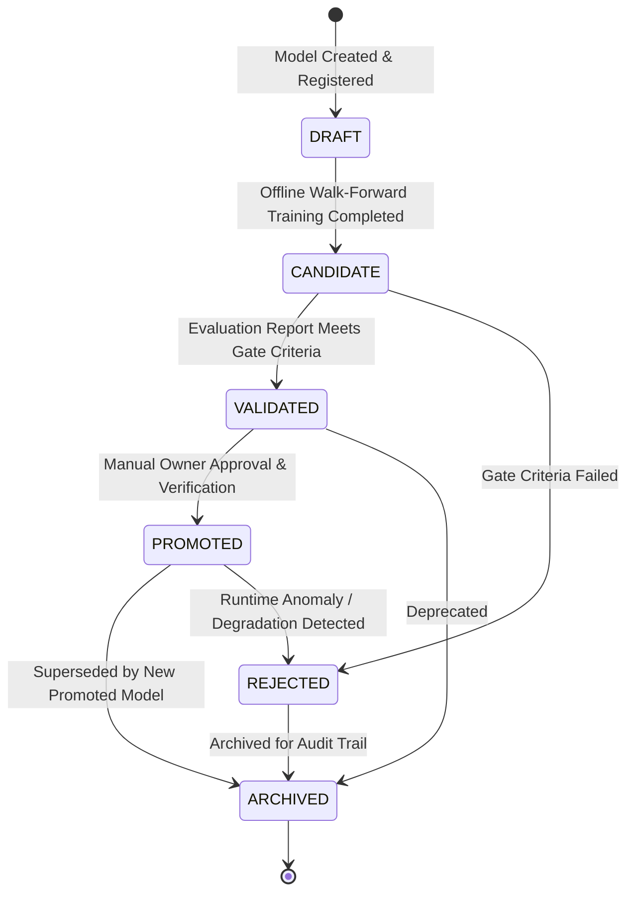

# MUNIM V2.5 — ML-2: Continuous Supplier Learning Infrastructure Architecture

**Status:** APPROVED ARCHITECTURE & IMPLEMENTATION BASELINE
**Phase:** V2.5 — ML-2 (Continuous Supplier Learning Infrastructure)
**Author:** MUNIM Engineering Team
**Last Updated:** November 2026
**Document Version:** 1.0.0

---

## 1. Executive Summary & Decoupling Rationale

MUNIM is an **Agentic Procurement & Profitability Copilot for Manufacturing MSMEs**. The core business logic operates on a deterministic Java `BigDecimal` engine for all financial calculations, margins, quotation approvals, and landed-cost reconciliations.

The **ML-1 Readiness Audit** established that:
1. The operational database contains zero authentic real-world factory outcome records.
2. The few existing records are synthetic demonstration data and test fixtures.
3. Training an ML model on synthetic or sparse data would produce dangerous hallucinations, misleading factory owners and distorting supplier relationships.

Therefore, **Phase V2.5 ML-2** establishes the **continuous learning infrastructure** without prematurely deploying or training a production prediction model. The system operates under the explicit operational status:
$$\text{Status} = \texttt{NO\_VALIDATED\_MODEL}$$

### Architectural Principles

1. **Strict Service Decoupling:** The ML engine resides in an isolated Python/FastAPI microservice (`ml-service`), while financial and operational transactions remain strictly inside the Spring Boot core (`backend`).
2. **Fail-Safe Client Policy:** If the ML service is down, degraded, timing out, or has no validated model, the Spring Boot core continues uninterrupted. Predictions fail gracefully with HTTP 503 (`NO_VALIDATED_MODEL`) or return empty optionals without breaking procurement flows.
3. **Temporal Point-in-Time Isolation ($T_{\text{placed}}$):** Any feature vector evaluated for a purchase order or quotation must use exclusively evidence created strictly before the event timestamp ($t < T_{\text{event}}$). Future receipts, quality inspections, and the order's own outcome are strictly sequestered to prevent target leakage.
4. **Non-Zero Unknown Principle:** Unknown historical supplier metrics (such as missing delivery rates or unobserved defect counts) must remain `null` / `None`. They are never silently imputed with `0.0`.
5. **Human Commercial Authority:** ML outputs are strictly advisory. No model score can autonomously approve quotations, award suppliers, create purchase orders, or alter deterministic financial calculations.
6. **Provenance Isolation:** Datasets marked `SYNTHETIC` and `REAL` must never be mixed into a unified training set.

---

## 2. System Architecture & Service Boundaries

```mermaid
flowchart TD
    subgraph External["External Network / Host"]
        User["Factory Owner / Operator<br/>(Browser)"]
    end

    subgraph Docker["Docker Compose Network: munim-network"]
        subgraph FrontendContainer["frontend (Port 5173:80)"]
            ReactUI["React + TypeScript UI<br/>(V2.4 Recommendations & V2.3 Scorecards)"]
        end

        subgraph BackendContainer["backend (Port 8080:8080)"]
            CoreAPI["Spring Boot Core Engine"]
            DetEng["Deterministic Java Engine<br/>(Profitability, Landed Cost, V2.4 Scoring)"]
            MlClient["SupplierMlClient<br/>(Fail-safe HTTP, Timeouts: 1s/2s)"]
            MlRepo["SupplierMlFeatureRepository<br/>(Point-in-Time SQL Isolation)"]
        end

        subgraph MlContainer["ml-service (Internal Only - Port 8000)"]
            FastAPIApp["FastAPI Service (Python 3.12)"]
            AuthMiddleware["Internal Secret Validator<br/>(X-Internal-ML-Key, HMAC Constant-Time)"]
            ModelRegistry["Model Registry & Lifecycle State Machine<br/>(State: NO_VALIDATED_MODEL)"]
            FeatureValidator["Feature Contract v1.0.0 Validator<br/>(Temporal & Non-Zero Checks)"]
            ProvenanceValidator["Dataset & Manifest Validator<br/>(SYNTHETIC vs REAL Isolation)"]
        end

        subgraph DbContainer["postgres (Port 5432:5432)"]
            PostgreSQL[("PostgreSQL 17 Database<br/>(Transactional Ledger, POs, Receipts, Inspections)")]
        end
    end

    User -->|HTTP / 5173| ReactUI
    ReactUI -->|REST / 8080| CoreAPI
    CoreAPI --> DetEng
    CoreAPI --> MlRepo
    MlRepo -->|SQL Query (t < T)| PostgreSQL
    CoreAPI --> MlClient
    MlClient -->|HTTP / 8000 + X-Internal-ML-Key| AuthMiddleware
    AuthMiddleware --> FastAPIApp
    FastAPIApp --> ModelRegistry
    FastAPIApp --> FeatureValidator
    FastAPIApp --> ProvenanceValidator
```

### Boundary Responsibilities

| Component | Technology | Responsibilities | Security Boundaries |
| :--- | :--- | :--- | :--- |
| **Spring Boot Core** | Java 21, Spring Boot 3.4 | Authoritative financial ledger, deterministic scoring, workflow state machines, point-in-time SQL feature extraction. | Public/Host port 8080. JWT authentication and role-based access control (`OWNER`, `PROCUREMENT_OPERATOR`, `READ_ONLY_EVALUATOR`). |
| **ML Microservice** | Python 3.12, FastAPI, scikit-learn | Feature vector schema validation, dataset provenance auditing, evaluation report contracts, model registry, inference execution. | **Internal Docker network only.** Port 8000 is not exposed to host. Requires `X-Internal-ML-Key` constant-time pre-shared secret. |
| **PostgreSQL 17** | PostgreSQL Alpine | Source of truth for all entities: RFQs, quotes, POs, receipts, quality inspections. | Port 5432 (mapped for local development/test runner). |

---

## 3. Local Development & Docker Compose Setup

### 3.1 Docker Compose Execution

To build and start the entire stack including the new `ml-service`:

```bash
# Build and run all services in detached mode
docker compose up -d --build

# Verify container statuses
docker compose ps

# Check ML microservice logs
docker compose logs -f ml-service

# Check Backend ML client connection
docker compose logs -f backend | grep -i "ml"
```

### 3.2 Running the Python ML Microservice Locally

```bash
cd ml

# Create and activate virtual environment
python3 -m venv venv
source venv/bin/activate

# Install dependencies
pip install -r requirements.txt

# Run FastAPI with Uvicorn
export INTERNAL_ML_SECRET="munim-internal-ml-secret-dev"
export ENV="development"
uvicorn app.main:app --host 0.0.0.0 --port 8000 --reload
```

### 3.3 Running ML Microservice Tests

```bash
cd ml
python3 -m pytest tests/ -v
```

---

## 4. Internal Security & Authentication Contract

Because the ML microservice manages sensitive factory data and model inference, it is secured by three defensive layers:

1. **Network Layer Isolation:** In `docker-compose.yml`, `ml-service` does not specify a `ports:` host mapping. It specifies `expose: ["8000"]`, rendering it reachable exclusively within the Docker bridge network (`munim-network`) by the `backend` container.
2. **Header-Based Authentication:** All incoming requests to `/api/v1/ml/*` require the header:
   ```http
   X-Internal-ML-Key: <INTERNAL_ML_SECRET>
   ```
3. **Timing-Attack Resistance:** The authentication dependency uses Python's standard `hmac.compare_digest(provided_key, expected_key)` to prevent timing side-channel attacks:

```python
# ml/app/auth.py
def verify_internal_key(x_internal_ml_key: Optional[str] = Header(None, alias="X-Internal-ML-Key")) -> None:
    expected_secret = settings.internal_ml_secret
    if not x_internal_ml_key or not hmac.compare_digest(x_internal_ml_key, expected_secret):
        raise HTTPException(
            status_code=status.HTTP_401_UNAUTHORIZED,
            detail="Invalid or missing internal ML authentication key.",
            headers={"WWW-Authenticate": "X-Internal-ML-Key"},
        )
```

Unauthenticated requests to protected endpoints return:
```json
{
  "detail": "Invalid or missing internal ML authentication key."
}
```

Public probe endpoints (`GET /health` and `GET /ready`) do not require the authentication header to allow orchestrator health probes.

---

## 5. API Endpoint Specifications

### 5.1 Health & Liveness
- **Method:** `GET /health`
- **Authentication:** None (Public)
- **Response:** `200 OK`
```json
{
  "status": "UP",
  "service": "munim-ml-service",
  "version": "0.1.0"
}
```

### 5.2 Readiness Probe
- **Method:** `GET /ready`
- **Authentication:** None (Public)
- **Response:** `200 OK` (when running without a production model)
```json
{
  "ready": true,
  "modelReady": false,
  "service": "munim-ml-service",
  "version": "0.1.0",
  "message": "ML service online. No validated model currently deployed."
}
```

### 5.3 Model Status
- **Method:** `GET /api/v1/ml/status`
- **Authentication:** `X-Internal-ML-Key: <secret>`
- **Response:** `200 OK`
```json
{
  "modelState": "NO_VALIDATED_MODEL",
  "activeModelId": null,
  "modelVersion": null,
  "featureSchemaVersion": "1.0.0",
  "totalHistoricalPredictions": 0,
  "serviceStatus": "HEALTHY",
  "message": "Continuous learning infrastructure ready. No production model validated for inference."
}
```

### 5.4 Delivery Risk Prediction
- **Method:** `POST /api/v1/ml/predict/delivery-risk`
- **Authentication:** `X-Internal-ML-Key: <secret>`
- **Payload:** Versioned feature vector matching `v1.0.0`
- **Response (when no validated model is loaded):** `503 Service Unavailable`
```json
{
  "detail": "No validated delivery-risk model is active. Operational state: NO_VALIDATED_MODEL"
}
```

### 5.5 Dataset Manifest Validation
- **Method:** `POST /api/v1/ml/datasets/validate-manifest`
- **Authentication:** `X-Internal-ML-Key: <secret>`
- **Purpose:** Audits a dataset manifest for point-in-time consistency, provenance isolation, and label validity.
- **Payload:**
```json
{
  "datasetId": "ds-kassia-pilot-2026-q1",
  "provenanceType": "REAL",
  "featureSchemaVersion": "1.0.0",
  "totalRecords": 150,
  "timeRangeStart": "2026-01-01T00:00:00Z",
  "timeRangeEnd": "2026-03-31T23:59:59Z",
  "records": [...]
}
```
- **Response:** `200 OK`
```json
{
  "valid": true,
  "datasetId": "ds-kassia-pilot-2026-q1",
  "totalRecords": 150,
  "provenanceType": "REAL",
  "featureSchemaVersion": "1.0.0",
  "errors": [],
  "warnings": []
}
```

---

## 6. Versioned Feature Contract (v1.0.0)

Feature contract `v1.0.0` guarantees mathematical consistency and temporal isolation across model training and inference.

### 6.1 Feature Schema Definition

| Field Name | Type | Unit / Range | Temporal Cutoff | Description & Handling Rule |
| :--- | :--- | :--- | :--- | :--- |
| `supplier_id` | UUID / String | Valid ID | Pre-existing | Unique identifier of the supplier. |
| `material_category` | String | Categorical | Quote creation | Category of material (e.g., `STEEL`, `PACKAGING`). |
| `purchase_order_value_inr` | Float | $> 0.0$ INR | $T_{\text{placed}}$ | Total value of the target purchase order. |
| `lead_time_days_promised` | Integer | $\ge 0$ Days | $T_{\text{placed}}$ | Promised lead time ($D_{\text{promised}} - D_{\text{placed}}$). |
| `supplier_historical_po_count` | Integer | $\ge 0$ Count | strictly $t < T_{\text{placed}}$ | Number of prior closed/settled POs for this supplier. |
| `supplier_historical_on_time_rate` | Float / Null | $[0.0, 1.0]$ or `null` | strictly $t < T_{\text{placed}}$ | Historical on-time delivery rate. **Must be `null` if historical PO count is 0. Silent zero-fill forbidden.** |
| `supplier_historical_rejection_rate` | Float / Null | $[0.0, 1.0]$ or `null` | strictly $t < T_{\text{placed}}$ | Historical material rejection rate. **Must be `null` if no inspection history exists.** |
| `supplier_historical_avg_delay_days` | Float / Null | $[0.0, \infty)$ or `null` | strictly $t < T_{\text{placed}}$ | Mean days late across delayed shipments. **Must be `null` if no delayed shipments.** |
| `category_order_frequency_prior_90d` | Integer | $\ge 0$ Count | $[T - 90d, T)$ | Factory's order frequency in this material category. |
| `supplier_active_concurrent_pos` | Integer | $\ge 0$ Count | at $T_{\text{placed}}$ | Concurrent unfulfilled POs currently open with this supplier. |
| `order_month` | Integer | $[1, 12]$ | $T_{\text{placed}}$ | Month of order placement (captures seasonal patterns). |
| `order_day_of_week` | Integer | $[0, 6]$ | $T_{\text{placed}}$ | Day of week of order placement (0 = Monday). |

### 6.2 Temporal Point-in-Time SQL Isolation

The feature extraction query implemented in [`SupplierMlFeatureRepository.java`](file:///Users/gopalguptamac/Downloads/GAVS-MUNIM/backend/src/main/java/org/munim/ml/SupplierMlFeatureRepository.java) strictly isolates historical facts:

```sql
SELECT
    COUNT(prior_po.id) AS historical_po_count,
    COUNT(CASE WHEN prior_po.po_delivery_status = 'ON_TIME' THEN 1 END) AS on_time_count,
    COUNT(CASE WHEN prior_po.po_delivery_status = 'LATE' THEN 1 END) AS late_count,
    ...
FROM purchase_orders prior_po
WHERE prior_po.supplier_id = :supplierId
  AND prior_po.created_at < :placedAt
  AND (
      prior_po.status = 'COMPLETED'
      OR prior_po.po_delivery_status = 'PO_SHORT_CLOSED'
      OR (prior_po.status IN ('ISSUED', 'PARTIALLY_DELIVERED') AND prior_po.promised_delivery_date < :placedAt)
  )
```

**Guarantees:**
1. Any PO placed on or after the target order timestamp `:placedAt` is discarded.
2. The target PO's own delivery date, receipt quantity, and quality score cannot leak into its feature vector.

---

## 7. Outcome Label Taxonomy & Edge Case Handling

In supervised learning for supplier delivery risk, the target label must capture delivery failure without confounding business decisions.

### 7.1 Label States

| Outcome Label | Binary Target ($y$) | Description & Business Meaning |
| :--- | :---: | :--- |
| `ON_TIME_COMPLETED` | $0$ (Negative) | Goods received in full with first completed receipt timestamp $\le$ promised delivery date. |
| `LATE_COMPLETED` | $1$ (Positive) | Goods received in full, but first completed receipt timestamp $>$ promised delivery date. |
| `FAILED_FULFILLMENT` | $1$ (Positive) | Supplier failed to fulfill: short-closed due to supplier default, or promised delivery date expired by $> 30$ days with missing goods. |
| `OPEN_OR_CENSORED` | Excluded ($None$) | Right-censored order: PO is currently open, promised date has not elapsed, or unconfirmed. Cannot be used as a training label. |
| `CANCELLED` | Excluded ($None$) | PO cancelled due to buyer-side changes (e.g., customer design change, cancelled sales order). Not a supplier delivery failure. |

### 7.2 Deterministic Derivation Function

The derivation logic in [`ml/app/schemas/labels.py`](file:///Users/gopalguptamac/Downloads/GAVS-MUNIM/ml/app/schemas/labels.py) enforces this mapping:

```python
def derive_outcome_label(
    status: str,
    po_delivery_status: Optional[str],
    promised_delivery_date: date,
    first_completed_at: Optional[datetime],
    short_closed_reason: Optional[str] = None,
    evaluation_time: Optional[datetime] = None,
) -> OutcomeLabel:
    if status == "CANCELLED":
        return OutcomeLabel.CANCELLED
    if po_delivery_status == "PO_SHORT_CLOSED":
        return OutcomeLabel.FAILED_FULFILLMENT
    if first_completed_at is not None:
        if first_completed_at.date() <= promised_delivery_date:
            return OutcomeLabel.ON_TIME_COMPLETED
        return OutcomeLabel.LATE_COMPLETED
    # Right-censored or overdue check
    eval_date = (evaluation_time or datetime.now(timezone.utc)).date()
    if status in ("ISSUED", "PARTIALLY_DELIVERED"):
        if eval_date > promised_delivery_date + timedelta(days=30):
            return OutcomeLabel.FAILED_FULFILLMENT
        return OutcomeLabel.OPEN_OR_CENSORED
    return OutcomeLabel.OPEN_OR_CENSORED
```

---

## 8. Dataset Provenance & Strict Isolation

To prevent data contamination, all dataset manifests must explicitly identify their provenance type:

```python
class ProvenanceType(str, Enum):
    SYNTHETIC = "SYNTHETIC"   # Mock records, factory generator scripts, test fixtures
    REAL = "REAL"             # Verified historical factory records (e.g. KASSIA pilot)
    BENCHMARK = "BENCHMARK"   # Standardized offline test sets
```

### Isolation Rules
1. **No Mixing:** Datasets containing records with `provenance_type == SYNTHETIC` cannot be combined with `provenance_type == REAL` for production model candidate evaluation.
2. **Immutable Hashing:** Every dataset record includes a SHA-256 manifest hash to guarantee auditable data lineage.
3. **Validation Pipeline:** The endpoint `POST /api/v1/ml/datasets/validate-provenance` enforces that all records in an uploaded batch strictly match the manifest's declared provenance type.

---

## 9. Model Lifecycle & Promotion State Machine

Models progress through an explicit governance state machine before being exposed to inference.



### State Definitions

| State | Inference Allowed | Transition Requirements |
| :--- | :---: | :--- |
| `DRAFT` | No | Model architecture specified; hyperparameters initialized. |
| `CANDIDATE` | No | Trained on offline dataset; evaluation report generated. |
| `VALIDATED` | No | Passed automated gating criteria (PR-AUC, Brier score, ECE, slice equity). |
| `PROMOTED` | **Yes** | Authorized by human system owner; registered in runtime service. |
| `REJECTED` | No | Failed evaluation gate or exhibited runtime drift/anomalies. |
| `ARCHIVED` | No | Retained strictly for historical auditability and reproducible research. |

---

## 10. Standardized Model Evaluation Report Contract

Before any candidate model can transition from `CANDIDATE` to `VALIDATED`, an evaluation report matching [`EvaluationReport`](file:///Users/gopalguptamac/Downloads/GAVS-MUNIM/ml/app/schemas/evaluation.py) must be submitted and validated.

### 10.1 Metric Requirements

Because delivery defaults are inherently imbalanced (typically 5%–20% late in factory settings), **ROC-AUC and Accuracy are insufficient and misleading**. The evaluation contract enforces:

1. **PR-AUC (Precision-Recall Area Under Curve):** Primary performance metric. Measures true late delivery capture across decision thresholds.
2. **Brier Score:** Mean squared probability error ($B \le 0.15$ target). Ensures output probabilities represent authentic risk.
3. **Expected Calibration Error (ECE):** Calibration assessment across 10 confidence bins ($\text{ECE} \le 0.10$ target). When the model outputs a 30% risk, approximately 30% of those orders must be late.
4. **Walk-Forward Validation:** Cross-validation must strictly preserve chronological order ($T_{\text{train}} < T_{\text{val}}$). Standard random k-fold cross-validation is **strictly prohibited** because it leaks temporal trends.
5. **Subgroup Slice Equity:** Disaggregated error rates across order value tiers (`LOW_VALUE`, `MEDIUM_VALUE`, `HIGH_VALUE`) and material categories to prevent systemic bias against small suppliers.

---

## 11. Spring Boot Integration: Fail-Safe HTTP Client

The Spring Boot client [`SupplierMlClient.java`](file:///Users/gopalguptamac/Downloads/GAVS-MUNIM/backend/src/main/java/org/munim/ml/SupplierMlClient.java) is designed around defensive microservice patterns:

```java
// Timeout & Fault Tolerance Contract
Connect Timeout: 1000 ms
Read Timeout:    2000 ms
Fail-Safe:       Returns Optional.empty() on connection loss, HTTP 5xx, or HTTP 503
```

### Safety Guarantees
- If `ml-service` is unreachable, `SupplierMlClient` catches `RestClientException`, logs a sanitized warning, and returns an empty result.
- Operational procurement workflows (RFQ generation, quotation extraction, landed cost calculation, and human purchase order awards) **never block or fail** due to ML service downtime.
- Internal service status can be queried at `GET /api/v1/internal/ml-status` by `OWNER` and `PROCUREMENT_OPERATOR` roles.

---

## 12. Known Limitations & Roadmap

### Why No Production Model is Deployed Today (ML-1 Findings)
The ML-1 audit verified that the MUNIM database contains insufficient authentic historical factory receipts. Deploying a model trained on random synthetic seeds would provide a false sense of precision, risking supply chain disruptions for manufacturing MSMEs.

### Pathway for Real Factory Pilot Data Ingestion
1. **Phase V2.5 ML-2 (Current):** Secure, containerized microservice infrastructure, point-in-time extraction, provenance validation, and lifecycle contracts deployed with zero unverified predictions.
2. **Phase V2.5 ML-3 (Synthetic Experimentation):** Benchmark baseline ML models (Logistic Regression, LightGBM, Random Forest) on isolated synthetic datasets to validate hyperparameter tuning and calibration pipelines.
3. **Phase V2.6 (KASSIA Factory Ingestion):** Ingest authentic, anonymized procurement and delivery records from pilot manufacturing clusters (KASSIA Peenya / Bangalore).
4. **Phase V2.7 (Candidate Validation & Promotion):** Train candidate models on authentic factory records using temporal walk-forward splits; promote the first validated delivery-risk model once ECE $\le 0.10$ and PR-AUC exceeds baseline benchmarks.
