# MUNIM V2 — Supplier Intelligence & Purchase Performance Tracking
## Comprehensive Architectural Specification & Phased Implementation Plan

**Document:** `docs/architecture/MUNIM_V2_SUPPLIER_INTELLIGENCE_PLAN.md`  
**Revision:** 2.6 (Final Completion Semantics & Short-Closure Invariants Specification)  
**Date:** 2026-11-20  
**Status:** FROZEN PRE-IMPLEMENTATION SPECIFICATION  
**Target Milestone:** MUNIM V2.0 / V2.1  

---

## 1. Executive Summary & Objective

MUNIM V1 delivered a deterministic sheet-metal procurement, production costing, and commercial quoting platform for Indian MSME fabrication workshops. In V1, the procurement loop terminates when an owner approves an RFQ award proposal (`rfqs.status = 'AWARDED'`). 

In practice, small manufacturing factory owners in industrial hubs like Peenya, Bhosari, and Chakan face severe post-award vulnerabilities:
1. **Unannounced Delivery Delays:** Suppliers quote 2-day delivery on WhatsApp to win the order, but deliver in 7 days, stalling CNC laser cutting and press brake operations.
2. **Quality & Dimensional Drift:** Material arrives out-of-spec (e.g. 1.82 mm delivered vs. 2.00 mm ordered), causing tool breakage and parts rejected by the end customer.
3. **Hidden Invoiced Surcharges:** The final invoice includes surprise unloading fees, demurrage, or unexpected freight increases, eroding production margins.

**MUNIM V2: Supplier Intelligence & Purchase Performance Tracking** completes this operational cycle. It tracks actual post-award outcomes—delivery timeliness, physical quality acceptance, and reconciled invoice costs—against the original commitments. This empirical evidence directly feeds future quotation evaluations, enabling factory owners to make procurement decisions grounded in verified performance rather than unsubstantiated claims.

---

## 2. Repository Audit: Baseline Architecture (V1–V4)

An exhaustive inspection of the MUNIM codebase confirms the following baseline:

### 2.1 Database Entities & Table Count Reconciled
The current PostgreSQL database contains **18 application tables** and **1 Flyway schema history table** (**19 total tables**), established across four frozen migrations:

```
┌───────────────────────────────────────────────────────────────────────────┐
│                      CURRENT DATABASE BASELINE (V1–V4)                    │
├──────────────────────────────┬────────────────────────────────────────────┤
│ Migration                    │ Application Tables Created                 │
├──────────────────────────────┼────────────────────────────────────────────┤
│ V1__procurement_slice.sql    │ materials, suppliers, rfqs,                │
│                              │ supplier_quotes, supplier_quote_revisions, │
│                              │ quote_evaluations, evaluation_lines,       │
│                              │ idempotency_records                        │
│ V2__approvals_and_audit.sql  │ commercial_proposals, approvals,           │
│                              │ audit_events                               │
│ V3__quote_intelligence...sql │ quote_extractions, clarification_messages   │
│ V4__profitability_and...sql  │ customer_enquiries, boms, bom_items,       │
│                              │ costing_sheets, customer_quotations        │
├──────────────────────────────┴────────────────────────────────────────────┤
│ Current Application Tables: 18 | Total Tables in DB (incl. flyway): 19    │
└───────────────────────────────────────────────────────────────────────────┘
```

### 2.2 Award & Purchase Mechanism Findings
1. **Existing Award Mechanism:**
   - There is currently **no `purchase_orders` or `purchase_receipts` table**.
   - RFQ awards exist purely as state transitions: `rfqs.status = 'AWARDED'`, linking `rfqs.awarded_quote_id` to `supplier_quotes.id` and `supplier_quotes.awarded_revision_id` to `supplier_quote_revisions.id`.
   - The award is authorized via a `commercial_proposals` record (`type = 'SUPPLIER_AWARD'`) approved by `OWNER` in `ApprovalService.java`.
2. **Existing Delivery & Quality Data:**
   - Quoted delivery is captured as `fields->>'promisedDeliveryAt'` in `supplier_quote_revisions`.
   - Factory required delivery is captured in `rfqs.required_procurement_delivery_at`.
   - Actual gate arrival timestamps, weighbridge slips, physical inspection acceptance/rejection counts, and invoice reconciliations are completely unrecorded.
3. **Existing Financial & Tax Engine:**
   - `FinancialEvaluator.java` strictly enforces that 100% creditable GST (Input Tax Credit) is excluded from Economic Landed Cost, while non-creditable GST is added to Economic Landed Cost.
   - All base amounts across MUNIM are **TAX-EXCLUSIVE**. V2 actual cost calculations strictly preserve this logic to ensure variance calculations are apples-to-apples.
4. **Relational Integrity Baseline (Confirmed in Code):**
   - Line 58 of `V1__procurement_slice.sql` explicitly establishes:
     `UNIQUE (id, rfq_id)` on `supplier_quote_revisions`.
   - Line 76 of `V1__procurement_slice.sql` establishes:
     `FOREIGN KEY (quote_revision_id, rfq_id) REFERENCES supplier_quote_revisions(id, rfq_id)` on `quote_evaluations`.
   - This proves that a composite foreign key `(quote_revision_id, rfq_id)` referencing `supplier_quote_revisions(id, rfq_id)` is natively supported and fully verified by existing schema constraints.

---

## 3. Entity Relationship Architecture (V2)

MUNIM V2 adds exactly **two new application tables**: `purchase_orders` and `purchase_receipts`. This brings the application table count from **18 to 20** (and total database tables in `information_schema.tables` from **19 to 21**).

### 3.1 Entity Relationship Diagram

```mermaid
erDiagram
    rfqs ||--|| purchase_orders : "awarded into (1:1)"
    suppliers ||--o{ purchase_orders : "receives"
    materials ||--o{ purchase_orders : "specifies"
    supplier_quote_revisions ||--o| purchase_orders : "originates from"
    commercial_proposals ||--o| purchase_orders : "authorized by"
    
    purchase_orders ||--o{ purchase_receipts : "fulfilled across 1..N"
    
    suppliers ||--o{ purchase_receipts : "delivered by"
    materials ||--o{ purchase_receipts : "received material"
    
    purchase_orders {
        uuid id PK
        text po_number UK "PO-YYYY-NNNN"
        uuid rfq_id FK,UK "1:1 with RFQ"
        uuid supplier_id FK
        uuid quote_revision_id FK
        uuid proposal_id FK
        uuid material_id FK
        numeric ordered_quantity "scale 4, > 0"
        text unit "kg, sheet, etc."
        numeric agreed_unit_price "scale 2, > 0"
        numeric agreed_freight_amount "scale 2, >= 0"
        text freight_basis "SEPARATE | INCLUDED_IN_UNIT_PRICE"
        numeric material_tax_rate "scale 2"
        text material_itc_status "CREDITABLE | NON_CREDITABLE"
        numeric freight_tax_rate "scale 2"
        text freight_itc_status "CREDITABLE | NON_CREDITABLE"
        numeric quoted_economic_landed_cost "contracted landed baseline"
        numeric quoted_cash_payable "contracted cash commitment"
        timestamptz promised_delivery_date
        text status "ISSUED | PARTIALLY_DELIVERED | COMPLETED | CANCELLED"
        numeric unfulfilled_quantity "scale 4, >= 0"
        text closure_reason "mandatory on manual closure"
        text closed_by "OWNER actor id"
        timestamptz closed_at
        timestamptz first_completed_at "immutable original completion date; NULL for short closures"
        text po_delivery_status "PO_ON_TIME | PO_DELAYED | PO_SHORT_CLOSED"
        text po_snapshot_hash "SHA-256 integrity"
        timestamptz created_at
        integer version
    }

    purchase_receipts {
        uuid id PK
        uuid purchase_order_id FK "RESTRICT on delete"
        uuid supplier_id FK "matches PO"
        uuid material_id FK "matches PO"
        integer receipt_sequence "1, 2, ... N for partials"
        text record_type "ORIGINAL | CORRECTION_ADJUSTMENT"
        uuid superseded_receipt_id FK "points to original receipt"
        text adjustment_type "PHYSICAL_RETURN | PHYSICAL_QUANTITY_CORRECTION | FINANCIAL_CREDIT_NOTE | FINANCIAL_DEBIT_NOTE"
        text correction_reason "mandatory for CORRECTION_ADJUSTMENT"
        
        text stage_delivery "RECORDED | PENDING"
        timestamptz actual_delivery_date
        numeric received_quantity "scale 4, > 0 for ORIGINAL"
        text delivery_challan_no
        text delivery_status "EARLY | ON_TIME | DELAYED"
        integer delay_days "signed integer"
        boolean is_critical_delay "true if delivery > factory deadline"
        
        text stage_quality "INSPECTED | NOT_INSPECTED | PENDING"
        numeric inspected_quantity "scale 4, <= received_qty"
        numeric accepted_quantity "scale 4, <= inspected_qty"
        numeric rejected_quantity "scale 4, inspected - accepted"
        numeric quality_acceptance_rate "scale 2, (accepted/inspected)*100"
        text rejection_reason "mandatory if rejected_qty > 0"
        text inspector_id
        timestamptz inspected_at
        
        text stage_invoice "RECONCILED | PENDING"
        text invoice_number
        timestamptz invoice_date
        numeric actual_material_base "scale 2, tax-exclusive, >= 0"
        numeric actual_material_gst "scale 2, >= 0"
        numeric actual_freight_base "scale 2, tax-exclusive, >= 0"
        numeric actual_freight_gst "scale 2, >= 0"
        numeric actual_other_expenses "scale 2, tax-exclusive, >= 0"
        numeric actual_other_expenses_gst "scale 2, >= 0"
        numeric other_expenses_tax_rate "scale 2, default 18.00"
        text other_expenses_itc_status "CREDITABLE | NON_CREDITABLE"
        text other_expenses_description
        numeric actual_economic_landed_cost "calculated per V1 tax rules"
        numeric actual_cash_paid "total gross cash outflow"
        numeric cost_variance_amount "actual landed - pro-rata quoted"
        numeric cost_variance_percentage "cost variance percentage"
        
        numeric delta_received_quantity "scale 4, signed delta"
        numeric delta_inspected_quantity "scale 4, signed delta"
        numeric delta_accepted_quantity "scale 4, signed delta"
        numeric delta_rejected_quantity "scale 4, signed delta"
        numeric delta_material_base "scale 2, signed delta"
        numeric delta_material_gst "scale 2, signed delta"
        numeric delta_freight_base "scale 2, signed delta"
        numeric delta_freight_gst "scale 2, signed delta"
        numeric delta_other_expenses "scale 2, signed delta"
        numeric delta_other_expenses_gst "scale 2, signed delta"
        numeric delta_economic_landed_cost "scale 2, signed delta"
        numeric delta_cash_paid "scale 2, signed delta"
        text credit_note_number
        
        text verification_status "UNVERIFIED | VERIFIED"
        text verified_by "OWNER role actor"
        timestamptz verified_at
        text outcome_snapshot_hash "SHA-256 sealed"
        timestamptz created_at
    }
```



---

## 4. Architectural Solutions & Core Formulations

### 4.1 Reconciling Original Receipt Evidence with Net Physical Fulfillment
In manufacturing supply chains, a supplier frequently delivers a 20-tonne steel order across multiple partial truckloads (e.g. 5 tonnes every 3 days). 
- If each partial receipt were treated as an independent on-time delivery, a supplier who delivers 3 partial drops on time (15 tonnes) but delivers the final 5 tonnes 10 days late would register a misleading **75% OTD rate**, despite stalling the entire production schedule.
- Conversely, a supplier who delivers the entire 20 tonnes in one single drop 1 day late would register **0% OTD**.

To establish empirical truth without statistical distortion, MUNIM V2 strictly decouples:
1. **`N_receipt` (Receipt-Event Count):** Counts physical original gate arrivals. Used exclusively for logistics throughput and operational reporting.
2. **Contract On-Time Delivery (PO-Level OTD %):** The authoritative commercial reliability metric, calculated strictly over eligible purchase orders.

#### 4.1.1 Receipt-Event Count ($N_{\text{receipt}}$)
$$N_{\text{receipt}} = \text{COUNT}(\text{id}) \quad \text{WHERE } record\_type = \text{'ORIGINAL'} \text{ AND } stage\_delivery = \text{'RECORDED'} \text{ AND } verification\_status = \text{'VERIFIED'}$$
- Measures receiving dock activity and storekeeper workload.
- **Strict Rule:** $N_{\text{receipt}}$ is **NEVER** used as the denominator for contract-level On-Time Delivery.

#### 4.1.2 Contractual PO Completion vs. Subsequent Quality Incidents
A Purchase Order is on-time if and only if its **contracted ordered quantity** is fully received on or before the committed delivery deadline.
1. **Original Evidence Immutability:**
   Original verified receipt records (`record_type = 'ORIGINAL'`) represent immutable physical evidence of what arrived at the gate. They are **never silently modified, overwritten, or deleted**.
2. **Exact Quantity for PO Completion (Effective Received Quantity):**
   Prior to contractual completion, physical fulfillment progress is evaluated by the cumulative net physical steel delivered to the shopfloor:
   $$Q_{\text{effective\_received}}(t) = \sum_{r \in \text{Verified Receipts}(t)} r.\text{received\_quantity}_{\text{orig}} + \sum_{\text{adj} \in \text{Verified Adjustments}(t)} adj.\text{delta\_received\_quantity}$$
3. **Pre-Completion Returns & Quantity Recounts:**
   If a physical return or weighbridge recount occurs *before* total ordered quantity is reached (e.g. 500 kg delivered in Truck 1, but 50 kg rejected and physically returned with `delta_received_quantity = -50.0000` before Truck 2 arrives):
   - The deduction reduces $Q_{\text{effective\_received}}$ to 450 kg.
   - When Truck 2 arrives with 500 kg, cumulative net received is $450 + 500 = 950$ kg.
   - Contractual completion is **NOT** reached because 50 kg remains missing. The PO remains open until the balance is delivered.
4. **Initial Contractual Completion Event (`first_completed_at`):**
   Initial completion occurs at the exact timestamp $T_{\text{complete}}$ when cumulative effective received quantity first satisfies the contract:
   $$\text{first\_completed\_at} = T_{\text{complete}} \iff Q_{\text{effective\_received}}(T_{\text{complete}}) \ge Q_{\text{ordered}}$$
   The completing consignment is $r_m$, and $\text{first\_completed\_at} = r_m.\text{actual\_delivery\_date}$.
5. **Contract Schedule Classification:**
   $$\Delta_{\text{PO}} = \text{Trunc}(\text{first\_completed\_at}) - \text{Trunc}(\text{po.promised\_delivery\_date})$$
   - `PO_ON_TIME`: $\Delta_{\text{PO}} \le 0$ (full ordered quantity delivered on or before promised delivery date).
   - `PO_DELAYED`: $\Delta_{\text{PO}} > 0$ (completion occurred after promised delivery date).
6. **Why Post-Completion Returns Do NOT Rewrite `first_completed_at`:**
   What occurs if physical material is returned or rejected *after* legitimate completion (e.g. latent metallurgical inclusions detected during CNC bending on Day 20 on an order legitimately completed on Day 4)?
   - An append-only adjustment is recorded: `record_type = 'CORRECTION_ADJUSTMENT'`, `adjustment_type = 'PHYSICAL_RETURN'`, `delta_accepted_quantity = -100.0000`, `delta_received_quantity = -100.0000`.
   - **Delivery Timeliness Invariant:** This subsequent return **DOES NOT rewrite `first_completed_at` or change `po_delivery_status`**.
   - **Rationale:** On Day 4, the supplier fulfilled their logistical transport contract by delivering 1,000 kg of ordered material to the factory dock. Erasing `first_completed_at` would rewrite history and falsely convert a **Quality Failure** into a **Logistical Delay**.
   - **Clean Metric Separation:**
     - **Delivery Timeliness:** Evaluated at gate delivery (`first_completed_at` = Day 4, `PO_ON_TIME`).
     - **Supplier Quality Incident:** The Day 20 return is captured strictly in the quality engine, reducing **Net Usable Yield Rate (%)** and increasing **Latent Defect Rate (%)**.
     - **Cost Reconciliation:** Captured via vendor Credit Note reducing net landed cost.

---

### 4.2 Short-Closed Purchase Order Invariants & Reopening Policy

#### 4.2.1 Short-Closure Invariants (`PO_SHORT_CLOSED`)
When a supplier short-delivers (e.g. 850 kg against a 1,000 kg order) and cannot supply the balance, the factory owner invokes `POST /api/v1/purchase-orders/{id}/close`:
1. **`first_completed_at` Invariant:**
   $$\text{first\_completed\_at} \equiv \text{NULL}$$
   Because the supplier **never** delivered the contracted volume, an initial completion timestamp was never achieved. Storing a timestamp would falsely imply fulfillment.
2. **Contract OTD Invariant:**
   - Short closure is **strictly non-compliant** for contract OTD.
   - `po_delivery_status = 'PO_SHORT_CLOSED'`.
   - Included in the OTD denominator ($N_{\text{PO, eligible}}$).
   - Excluded from the OTD numerator.
   - Administrative closure by the owner is an operational necessity to de-commit capital, but **never counts as a successful delivery**.
3. **Fulfillment Tracking & Scorecard Impact:**
   - `unfulfilled_quantity = max(0, ordered_quantity - cumulative_received) = 150.0000 kg`.
   - `closure_reason` recorded (minimum 10 characters).
   - Increments the supplier's **Short-Shipment Incident Count** and lowers their **Order Fulfillment Rate (%)** ($\frac{850}{1000} \times 100 = 85.0\%$).

#### 4.2.2 PO Reopening Policy & Historical Audit Preservation
In rare MSME manufacturing scenarios, a supplier may notify the factory 3 weeks later that new coil stock has arrived, and the owner agrees to accept the remaining 150 kg:
1. **Reopening Governance:**
   - Permitted **ONLY** via dedicated endpoint: `POST /api/v1/purchase-orders/{id}/reopen`.
   - Strictly gated to `ROLE_OWNER` via `DemoAuthFilter`.
   - Requires mandatory `reopen_reason` (minimum 10 characters).
2. **Historical Preservation Invariant:**
   - The original short-closure event is **never erased**.
   - An immutable audit log is persisted in `audit_events`:
     `action = 'PURCHASE_ORDER_REOPENED'`, recording prior `closure_reason`, prior `unfulfilled_quantity`, and new `reopen_reason`.
3. **State Transitions upon Reopening:**
   - Status transitions from `COMPLETED` back to `PARTIALLY_DELIVERED`.
   - `unfulfilled_quantity` is reset to active state (`0.0000`).
   - `first_completed_at` remains `null`.
4. **Subsequent Completion Evaluation:**
   - When the supplier delivers the remaining 150 kg on Day 25, cumulative received quantity reaches 1,000 kg.
   - Initial completion timestamp is now stamped: `first_completed_at = Day 25`.
   - Evaluated against original promised date (Day 5), the PO is classified as **`PO_DELAYED`** ($\Delta = +20$ days) for Contract OTD. Reopening does **not** allow late shipments to masquerade as on-time deliveries.

---

### 4.3 OTD Denominator & Missing Data Rules (Non-Zero Unknown Principle)
1. **Eligible POs for OTD Denominator ($N_{\text{PO, eligible}}$):**
   - **Fully Delivered POs:** Cumulative net received quantity $\ge Q_{\text{ordered}}$.
   - **Short-Shipped Closed POs:** Closed by Owner with `unfulfilled_quantity > 0` (`first_completed_at IS NULL`).
   - **Overdue Open POs:** Still open (`status IN ('ISSUED', 'PARTIALLY_DELIVERED')`) and cumulative received $< Q_{\text{ordered}}$, BUT current date $> \text{po.promised\_delivery\_date}$. (The vendor missed the contractual deadline; counts as delayed in the denominator!).
2. **Excluded POs (NOT in OTD Denominator):**
   - **POs Not Yet Due:** Open POs where current date $\le \text{po.promised\_delivery\_date}$.
   - **Cancelled POs:** Terminated prior to receipt due to factory commercial cancellation (`status = 'CANCELLED'`).
   - **Disputed POs:** Receipts under active unverified dispute (`verification_status = 'UNVERIFIED'`).
3. **Contract OTD Formula:**
   $$\text{Contract OTD Rate (\%)} = \left(\frac{\text{Count of Eligible POs with } \text{PO\_ON\_TIME}}{N_{\text{PO, eligible}}}\right) \times 100$$
4. **Missing Data Handling:**
   If $N_{\text{PO, eligible}} = 0$ (e.g. new supplier, or all active POs are not yet due):
   $$\text{Contract OTD Rate} = \text{null (rendered as '—')}$$
   It is **NEVER** defaulted to `0.00%`.

---

### 4.4 Partial Delivery Visibility & Consignment Logistics Metrics
To avoid confusing average delivery frequency with partial-delivery incidence, MUNIM V2 defines two distinct, mathematically precise metrics:

1. **Average Consignments per Completed PO (`averageConsignmentsPerCompletedPo`):**
   Measures the average number of truckloads/consignments required to fulfill a completed order:
   $$\text{averageConsignmentsPerCompletedPo} = \frac{\sum_{p \in \text{Completed POs with History}} N_{\text{receipt}}(p)}{N_{\text{PO, completed\_with\_receipt\_history}}}$$
   - *Denominator:* Count of completed POs that have verified original receipt history. Excludes legacy/cancelled POs without receipt records.
   - *Example:* A score of `2.4` indicates the supplier averages 2.4 truck drops per completed purchase order.
2. **Partial Delivery Order Rate (`partialDeliveryOrderRate` %):**
   Measures the percentage of completed orders that were delivered across multiple consignments:
   $$\text{partialDeliveryOrderRate (\%)} = \left(\frac{\text{Count of Completed POs with } N_{\text{receipt}} > 1}{N_{\text{PO, completed\_with\_receipt\_history}}}\right) \times 100$$
   - *Example:* A score of `40.0%` means 4 out of 10 completed orders required more than one delivery consignment.
3. **Consignment On-Time Rate (%):**
   Percentage of individual truckloads that arrived on or before the vendor's promised date:
   $$\text{Consignment On-Time Rate (\%)} = \left(\frac{\text{Count of Receipts with } r.\text{delivery\_status} \in (\text{'ON\_TIME'}, \text{'EARLY'})}{N_{\text{receipt}}}\right) \times 100$$
4. **Average Completion Delay (Days):**
   Average lateness across late-completed purchase orders:
   $$\text{Avg PO Delay Days} = \frac{\sum_{\text{delayed POs}} (\text{first\_completed\_at} - \text{promised\_delivery\_date})}{N_{\text{PO, delayed}}}$$

---

### 4.5 Adjustment Schema: Physical vs. Financial Adjustments & Constraint Integrity
1. **The Conflict Resolved:**
   Original fields are strictly non-negative (`>= 0`) and apply exclusively when `record_type = 'ORIGINAL'`. Dedicated `delta_*` fields handle signed adjustments exclusively when `record_type = 'CORRECTION_ADJUSTMENT'`.
2. **Explicit Adjustment Type Taxonomy:**
   Every adjustment record must specify an `adjustment_type`:
   - `PHYSICAL_RETURN`: Material rejected post-intake on the shopfloor and physically returned to the vendor.
   - `PHYSICAL_QUANTITY_CORRECTION`: Weighbridge recalibration or package recount error discovered post-verification.
   - `FINANCIAL_CREDIT_NOTE`: Commercial discount, scrap credit, or freight refund where *no physical material is returned*.
   - `FINANCIAL_DEBIT_NOTE`: Supplementary invoice or authorized freight surcharge with *no physical quantity change*.
3. **Database-Level Invariant for Financial-Only Adjustments:**
   When `adjustment_type IN ('FINANCIAL_CREDIT_NOTE', 'FINANCIAL_DEBIT_NOTE')`:
   $$\text{delta\_received\_quantity} = 0 \quad \land \quad \text{delta\_inspected\_quantity} = 0 \quad \land \quad \text{delta\_accepted\_quantity} = 0 \quad \land \quad \text{delta\_rejected\_quantity} = 0$$
   This is enforced by database `CHECK` constraints, guaranteeing that financial-only adjustments **never** mutate physical inventory or quality metrics.
4. **Multiple Adjustments ($1:N$) without Inflating Delivery Counts:**
   - Multiple adjustment records can point to the same original verified receipt (`superseded_receipt_id = <original_id>`).
   - Delivery metrics aggregate strictly over rows where `record_type = 'ORIGINAL'` and `stage_delivery = 'RECORDED'`.
   - Having 1, 5, or 10 adjustments on a receipt **never** increments the consignment delivery count ($N_{\text{receipt}}$).

---

### 4.6 Quality Metric Corrections: Gate Acceptance vs. Net Usable Yield
1. **Metric A: Gate Inspection Acceptance Rate (%) [Immutable Initial Conformance]:**
   Evaluates initial physical condition upon arrival at the factory:
   $$\text{Gate Acceptance Rate (\%)} = \left(\frac{\sum_{\text{orig}} \text{accepted\_quantity}}{\sum_{\text{orig}} \text{inspected\_quantity}}\right) \times 100$$
2. **Metric B: Net Usable Yield Rate (%) [Post-Adjustment Manufacturing Yield]:**
   Incorporates post-inspection latent shopfloor defect rejections, physical returns, and recount corrections:
   $$\text{Net Usable Yield Rate (\%)} = \left(\frac{\sum_{\text{orig}} \text{accepted\_quantity} + \sum_{\text{adj}} \text{delta\_accepted\_quantity}}{\sum_{\text{orig}} \text{inspected\_quantity} + \sum_{\text{adj}} \text{delta\_inspected\_quantity}}\right) \times 100$$
   - For post-inspection defect discoveries where material is rejected without changing the original inspected quantity, $\sum_{\text{adj}} \text{delta\_inspected\_quantity} = 0$, so the denominator remains the total original inspected quantity.
   - For financial-only credit notes, all `delta_*_quantity` fields are 0, so the Net Usable Yield Rate is **completely unaffected**.
3. **Metric C: Latent Defect Return Rate (%):**
   $$\text{Latent Defect Rate (\%)} = \left(\frac{|\sum_{\text{adj, physical}} \text{delta\_accepted\_quantity}|}{\sum_{\text{orig}} \text{accepted\_quantity}}\right) \times 100$$

---

### 4.7 Cumulative Over-Delivery Policy & Fair Financial Reconciliation
1. **Cumulative Application of +10% Tolerance across the PO:**
   The $+10\%$ rolling tolerance applies **CUMULATIVELY across the entire Purchase Order**:
   $$Q_{\text{authorized\_max}} = Q_{\text{ordered}} \times 1.10$$
   - Total cumulative receipts up to $Q_{\text{authorized\_max}}$ are classified as **Authorized Over-Delivery**.
   - Cumulative receipts exceeding $Q_{\text{authorized\_max}}$ require explicit manager authorization (`over_delivery_authorized = true` in Stage 1 intake).
2. **Authorized Material Baseline Calculation (Anti-Price-Spike Protection):**
   When legitimate over-delivery occurs (e.g. 5,180 kg delivered against a 5,000 kg order, $+3.6\% \le +10\%$):
   - The workshop legitimately consumes all 5,180 kg at the contracted unit price.
   - To prevent legitimate volume from appearing as an unauthorized price hike:
     $$\text{Authorized Material Quoted Base} = Q_{\text{received\_authorized}} \times \text{PO Agreed Unit Price}$$
     Where $Q_{\text{received\_authorized}} = \min(\sum Q_{\text{received}}, Q_{\text{ordered}} \times 1.10)$.
   - If the supplier invoiced exactly the contracted unit price (e.g. ₹65.00/kg) for all 5,180 kg:
     $$\text{Material Price Variance} = \text{Actual Material Base} - \text{Authorized Material Quoted Base} = (5,180 \times 65) - (5,180 \times 65) = ₹0.00 \text{ (0.00\%)!}$$
3. **Separate Freight Allocation Capped at PO Commitment:**
   - Contracted freight is allocated separately from material base.
   - Quoted freight baseline is **CAPPED at 100% of the PO Agreed Freight Commitment**:
     $$\text{Allocated Quoted Freight} = \text{PO Agreed Freight}$$
   - Any actual freight billed in excess of the agreed freight is an unauthorized variance:
     $$\text{Freight Variance} = \text{Actual Freight Base} - \text{PO Agreed Freight}$$
   - If `freight_basis = 'INCLUDED_IN_UNIT_PRICE'`: Agreed freight is ₹0. Any freight billed on invoice is an unauthorized surcharge.
4. **Complete Reconciled Baseline Formula for Over-Delivery:**
   $$\text{Authorized Landed Baseline} = (Q_{\text{received\_authorized}} \times \text{Agreed Unit Price}) + \text{PO Agreed Freight} + \text{Non-Creditable Tax Allowance}$$

---

### 4.8 Adjustment Impact Taxonomy Matrix

| Adjustment Type | Delivery Metrics ($N_{\text{PO, eligible}}$, Contract OTD) | Quality Metrics (Gate Acceptance Rate) | Quality Metrics (Net Usable Yield Rate) | Cost Metrics (Actual Landed & Cost Variance) |
|---|---|---|---|---|
| **`PHYSICAL_RETURN`** | **NO IMPACT** (`first_completed_at` & `po_delivery_status` remain frozen) | **NO IMPACT** (Original gate inspection frozen) | **DECREASES** (Negative $\Delta Q_{\text{accepted}}$ reduces usable yield) | **DECREASES** (Negative $\Delta \text{Cost}$ reduces actual spend via credit note) |
| **`PHYSICAL_QUANTITY_CORRECTION`** | **UPDATES** only if recalibration shifts original completion date | **NO IMPACT** (Original gate inspection frozen) | **UPDATES** (Adjusts yield by signed $\Delta Q_{\text{accepted}}$ and $\Delta Q_{\text{inspected}}$) | **UPDATES** (Adjusts material cost by $\Delta Q \times \text{Unit Price}$) |
| **`FINANCIAL_CREDIT_NOTE`** | **NO IMPACT** (Strictly zero) | **NO IMPACT** (Strictly zero) | **NO IMPACT** (Strictly zero; physical deltas are 0) | **DECREASES** (Negative $\Delta \text{Cost}$ reduces actual landed cost, improving variance) |
| **`FINANCIAL_DEBIT_NOTE`** | **NO IMPACT** (Strictly zero) | **NO IMPACT** (Strictly zero) | **NO IMPACT** (Strictly zero; physical deltas are 0) | **INCREASES** (Positive $\Delta \text{Cost}$ increases actual landed cost, worsening variance) |

---

### 4.9 Denominator Behavior under Insufficient or Missing Information
In strict adherence to Rule 2 (Non-Zero Unknown Principle):
1. **Quality Denominator ($Q_{\text{inspected}}$):**
   - If a receipt is marked `stage_quality = 'NOT_INSPECTED'`, its inspected quantity is `null`.
   - Denominator:
     $$\text{Quality Denominator} = \sum_{\text{orig, inspected}} \text{inspected\_quantity} + \sum_{\text{adj, physical}} \text{delta\_inspected\_quantity}$$
   - If total verified inspected quantity is zero ($\sum Q_{\text{inspected}} = 0$), both Gate Acceptance Rate and Net Usable Yield are **`null` (rendered as `—`)**, NEVER defaulted to `0.00%`.
2. **Contract OTD Denominator ($N_{\text{PO, eligible}}$):**
   - If $N_{\text{PO, eligible}} = 0$, Contract OTD is **`null` (rendered as `—`)**, NEVER `0.00%`.
3. **Cost Variance Denominator (Quoted Landed):**
   - Evaluated strictly over reconciled invoices where `stage_invoice = 'RECONCILED'`.
   - If no verified receipts with reconciled invoices exist, Cost Variance is **`null` (rendered as `—`)**.
4. **Confidence Tiers:**
   - `UNRATED`: $N_{\text{PO, completed}} = 0$ (*"No verified purchase history"*).
   - `LOW`: $N_{\text{PO, completed}} = 1$ (*"Single order history — preliminary"*).
   - `MEDIUM`: $N_{\text{PO, completed}} \in [2, 4]$.
   - `HIGH`: $N_{\text{PO, completed}} \ge 5$ across distinct purchase orders.

---

### 4.10 Transactional Award Approval & Rollback Architecture
1. **Facade Delegation:**
   Every approval route in `ApprovalController.java` (`POST /proposals/{id}/decision` and `POST /approvals/{id}/decision`) delegates to `AwardApprovalFacade.decide(...)`.
2. **Proposal Type Routing:**
   - `SUPPLIER_AWARD` + `APPROVE`: Calls `approvalService.decide(...)` and `supplierIntelligenceService.createPurchaseOrder(...)` within a single `@Transactional(rollbackFor = Exception.class)` boundary.
   - `CUSTOMER_QUOTE` (or `REJECT` on any proposal): Calls `approvalService.decide(...)` only. **No Purchase Order is created.**
3. **Atomic Rollback Guarantee:**
   If PO generation encounters any failure (constraint violation, snapshot hash error, sequence collision), the transaction issues an immediate rollback: proposal remains `PENDING`, RFQ remains `EVALUATED`, and no orphan PO or approval log is persisted.
4. **Preserves Frozen Code:** `ApprovalService.java` is called directly without changes.

---

## 5. Proposed Database Schema: Migration `V5`

```sql
-- Migration V5: Purchase Orders, Receipts, Quality Inspections, and Financial Reconciliations

-- 1. Purchase Orders table (created upon RFQ award approval)
CREATE TABLE IF NOT EXISTS purchase_orders (
  id UUID PRIMARY KEY DEFAULT gen_random_uuid(),
  po_number TEXT NOT NULL UNIQUE,
  rfq_id UUID NOT NULL REFERENCES rfqs(id),
  supplier_id UUID NOT NULL REFERENCES suppliers(id),
  quote_revision_id UUID NOT NULL REFERENCES supplier_quote_revisions(id),
  proposal_id UUID REFERENCES commercial_proposals(id),
  material_id UUID NOT NULL REFERENCES materials(id),
  ordered_quantity NUMERIC(14,4) NOT NULL CHECK (ordered_quantity > 0),
  unit TEXT NOT NULL,
  agreed_unit_price NUMERIC(12,2) NOT NULL CHECK (agreed_unit_price > 0),
  agreed_freight_amount NUMERIC(12,2) NOT NULL DEFAULT 0.00 CHECK (agreed_freight_amount >= 0),
  freight_basis TEXT NOT NULL DEFAULT 'SEPARATE' CHECK (freight_basis IN ('SEPARATE', 'INCLUDED_IN_UNIT_PRICE')),
  material_tax_rate NUMERIC(5,2) NOT NULL DEFAULT 18.00 CHECK (material_tax_rate >= 0 AND material_tax_rate <= 100),
  material_itc_status TEXT NOT NULL CHECK (material_itc_status IN ('CREDITABLE', 'NON_CREDITABLE')),
  freight_tax_rate NUMERIC(5,2) NOT NULL DEFAULT 0.00 CHECK (freight_tax_rate >= 0 AND freight_tax_rate <= 100),
  freight_itc_status TEXT NOT NULL DEFAULT 'CREDITABLE' CHECK (freight_itc_status IN ('CREDITABLE', 'NON_CREDITABLE')),
  quoted_economic_landed_cost NUMERIC(14,2) NOT NULL CHECK (quoted_economic_landed_cost >= 0),
  quoted_cash_payable NUMERIC(14,2) NOT NULL CHECK (quoted_cash_payable >= 0),
  promised_delivery_date TIMESTAMPTZ NOT NULL,
  status TEXT NOT NULL DEFAULT 'ISSUED' CHECK (status IN ('ISSUED', 'PARTIALLY_DELIVERED', 'COMPLETED', 'CANCELLED')),
  unfulfilled_quantity NUMERIC(14,4) NOT NULL DEFAULT 0.0000 CHECK (unfulfilled_quantity >= 0),
  closure_reason TEXT,
  closed_by TEXT,
  closed_at TIMESTAMPTZ,
  first_completed_at TIMESTAMPTZ,
  po_delivery_status TEXT CHECK (po_delivery_status IS NULL OR po_delivery_status IN ('PO_ON_TIME', 'PO_DELAYED', 'PO_SHORT_CLOSED')),
  notes TEXT,
  po_snapshot_hash TEXT NOT NULL,
  created_at TIMESTAMPTZ NOT NULL DEFAULT now(),
  updated_at TIMESTAMPTZ NOT NULL DEFAULT now(),
  version INTEGER NOT NULL DEFAULT 0,
  CONSTRAINT uq_purchase_orders_rfq UNIQUE (rfq_id),
  CONSTRAINT fk_po_quote_revision_rfq FOREIGN KEY (quote_revision_id, rfq_id) REFERENCES supplier_quote_revisions(id, rfq_id),
  CONSTRAINT chk_po_delivery_status_completed CHECK (
    (po_delivery_status = 'PO_SHORT_CLOSED' AND first_completed_at IS NULL) OR
    (po_delivery_status != 'PO_SHORT_CLOSED' OR po_delivery_status IS NULL)
  )
);

CREATE INDEX IF NOT EXISTS idx_purchase_orders_supplier ON purchase_orders(supplier_id);
CREATE INDEX IF NOT EXISTS idx_purchase_orders_rfq ON purchase_orders(rfq_id);
CREATE INDEX IF NOT EXISTS idx_purchase_orders_status ON purchase_orders(status);
CREATE INDEX IF NOT EXISTS idx_purchase_orders_delivery_status ON purchase_orders(po_delivery_status);

-- 2. Purchase Receipts table (Multi-stage delivery, quality, and invoice reconciliation)
CREATE TABLE IF NOT EXISTS purchase_receipts (
  id UUID PRIMARY KEY DEFAULT gen_random_uuid(),
  purchase_order_id UUID NOT NULL REFERENCES purchase_orders(id) ON DELETE RESTRICT,
  supplier_id UUID NOT NULL REFERENCES suppliers(id),
  material_id UUID NOT NULL REFERENCES materials(id),
  receipt_sequence INTEGER NOT NULL DEFAULT 1 CHECK (receipt_sequence > 0),
  record_type TEXT NOT NULL DEFAULT 'ORIGINAL' CHECK (record_type IN ('ORIGINAL', 'CORRECTION_ADJUSTMENT')),
  superseded_receipt_id UUID REFERENCES purchase_receipts(id),
  adjustment_type TEXT CHECK (adjustment_type IS NULL OR adjustment_type IN ('PHYSICAL_RETURN', 'PHYSICAL_QUANTITY_CORRECTION', 'FINANCIAL_CREDIT_NOTE', 'FINANCIAL_DEBIT_NOTE')),
  correction_reason TEXT,
  
  -- Stage 1: Gate Delivery Intake (Applies to ORIGINAL records)
  stage_delivery TEXT NOT NULL DEFAULT 'PENDING' CHECK (stage_delivery IN ('PENDING', 'RECORDED')),
  actual_delivery_date TIMESTAMPTZ,
  received_quantity NUMERIC(14,4) CHECK (received_quantity IS NULL OR received_quantity > 0),
  delivery_challan_no TEXT,
  delivery_status TEXT CHECK (delivery_status IN ('EARLY', 'ON_TIME', 'DELAYED')),
  delay_days INTEGER,
  is_critical_delay BOOLEAN NOT NULL DEFAULT FALSE,
  
  -- Stage 2: Shopfloor Quality Inspection (Applies to ORIGINAL records)
  stage_quality TEXT NOT NULL DEFAULT 'PENDING' CHECK (stage_quality IN ('PENDING', 'INSPECTED', 'NOT_INSPECTED')),
  inspected_quantity NUMERIC(14,4) CHECK (inspected_quantity IS NULL OR inspected_quantity > 0),
  accepted_quantity NUMERIC(14,4) CHECK (accepted_quantity IS NULL OR accepted_quantity >= 0),
  rejected_quantity NUMERIC(14,4) CHECK (rejected_quantity IS NULL OR rejected_quantity >= 0),
  quality_acceptance_rate NUMERIC(5,2) CHECK (quality_acceptance_rate >= 0.00 AND quality_acceptance_rate <= 100.00),
  rejection_reason TEXT,
  inspector_id TEXT,
  inspector_notes TEXT,
  inspected_at TIMESTAMPTZ,
  
  -- Stage 3: Invoice & Landed Cost Reconciliation (Applies to ORIGINAL records; Tax-Exclusive Base)
  stage_invoice TEXT NOT NULL DEFAULT 'PENDING' CHECK (stage_invoice IN ('PENDING', 'RECONCILED')),
  invoice_number TEXT,
  invoice_date TIMESTAMPTZ,
  actual_material_base NUMERIC(14,2) CHECK (actual_material_base IS NULL OR actual_material_base >= 0),
  actual_material_gst NUMERIC(14,2) DEFAULT 0.00 CHECK (actual_material_gst >= 0),
  actual_freight_base NUMERIC(14,2) DEFAULT 0.00 CHECK (actual_freight_base >= 0),
  actual_freight_gst NUMERIC(14,2) DEFAULT 0.00 CHECK (actual_freight_gst >= 0),
  actual_other_expenses NUMERIC(14,2) DEFAULT 0.00 CHECK (actual_other_expenses >= 0),
  actual_other_expenses_gst NUMERIC(14,2) DEFAULT 0.00 CHECK (actual_other_expenses_gst >= 0),
  other_expenses_tax_rate NUMERIC(5,2) DEFAULT 18.00 CHECK (other_expenses_tax_rate >= 0 AND other_expenses_tax_rate <= 100),
  other_expenses_itc_status TEXT DEFAULT 'CREDITABLE' CHECK (other_expenses_itc_status IN ('CREDITABLE', 'NON_CREDITABLE')),
  other_expenses_description TEXT,
  actual_economic_landed_cost NUMERIC(14,2) CHECK (actual_economic_landed_cost IS NULL OR actual_economic_landed_cost >= 0),
  actual_cash_paid NUMERIC(14,2) CHECK (actual_cash_paid IS NULL OR actual_cash_paid >= 0),
  cost_variance_amount NUMERIC(14,2),
  cost_variance_percentage NUMERIC(6,2),
  currency TEXT NOT NULL DEFAULT 'INR' CHECK (currency = 'INR'),
  
  -- Dedicated Signed Adjustment Delta Fields (Populated ONLY when record_type = 'CORRECTION_ADJUSTMENT')
  delta_received_quantity NUMERIC(14,4) DEFAULT 0.0000,
  delta_inspected_quantity NUMERIC(14,4) DEFAULT 0.0000,
  delta_accepted_quantity NUMERIC(14,4) DEFAULT 0.0000,
  delta_rejected_quantity NUMERIC(14,4) DEFAULT 0.0000,
  delta_material_base NUMERIC(14,2) DEFAULT 0.00,
  delta_material_gst NUMERIC(14,2) DEFAULT 0.00,
  delta_freight_base NUMERIC(14,2) DEFAULT 0.00,
  delta_freight_gst NUMERIC(14,2) DEFAULT 0.00,
  delta_other_expenses NUMERIC(14,2) DEFAULT 0.00,
  delta_other_expenses_gst NUMERIC(14,2) DEFAULT 0.00,
  delta_economic_landed_cost NUMERIC(14,2) DEFAULT 0.00,
  delta_cash_paid NUMERIC(14,2) DEFAULT 0.00,
  credit_note_number TEXT,
  
  -- Stage 4: Owner Verification & Audit Seal
  verification_status TEXT NOT NULL DEFAULT 'UNVERIFIED' CHECK (verification_status IN ('UNVERIFIED', 'VERIFIED')),
  verified_by TEXT,
  verified_at TIMESTAMPTZ,
  outcome_snapshot_hash TEXT,
  created_at TIMESTAMPTZ NOT NULL DEFAULT now(),
  updated_at TIMESTAMPTZ NOT NULL DEFAULT now(),
  
  -- Record Type Segregation Constraints
  CONSTRAINT chk_receipt_record_type CHECK (
    (record_type = 'ORIGINAL' AND superseded_receipt_id IS NULL AND adjustment_type IS NULL AND delta_received_quantity = 0.0000 AND delta_inspected_quantity = 0.0000 AND delta_accepted_quantity = 0.0000 AND delta_material_base = 0.00) OR
    (record_type = 'CORRECTION_ADJUSTMENT' AND superseded_receipt_id IS NOT NULL AND adjustment_type IS NOT NULL AND correction_reason IS NOT NULL AND length(trim(correction_reason)) >= 10)
  ),
  -- Invariant for Financial-Only Adjustments
  CONSTRAINT chk_financial_only_adjustment_deltas CHECK (
    adjustment_type NOT IN ('FINANCIAL_CREDIT_NOTE', 'FINANCIAL_DEBIT_NOTE') OR
    (delta_received_quantity = 0.0000 AND delta_inspected_quantity = 0.0000 AND delta_accepted_quantity = 0.0000 AND delta_rejected_quantity = 0.0000)
  ),
  -- Quality constraints for ORIGINAL records
  CONSTRAINT chk_receipt_inspected_lte_received CHECK (
    record_type = 'CORRECTION_ADJUSTMENT' OR inspected_quantity IS NULL OR received_quantity IS NULL OR inspected_quantity <= received_quantity
  ),
  CONSTRAINT chk_receipt_accepted_lte_inspected CHECK (
    record_type = 'CORRECTION_ADJUSTMENT' OR accepted_quantity IS NULL OR inspected_quantity IS NULL OR (accepted_quantity >= 0 AND accepted_quantity <= inspected_quantity)
  ),
  CONSTRAINT chk_receipt_rejected_lte_inspected CHECK (
    record_type = 'CORRECTION_ADJUSTMENT' OR rejected_quantity IS NULL OR inspected_quantity IS NULL OR (rejected_quantity >= 0 AND rejected_quantity <= inspected_quantity)
  ),
  CONSTRAINT chk_receipt_inspection_sum CHECK (
    record_type = 'CORRECTION_ADJUSTMENT' OR inspected_quantity IS NULL OR (accepted_quantity + rejected_quantity = inspected_quantity)
  ),
  CONSTRAINT chk_receipt_rejection_reason CHECK (
    record_type = 'CORRECTION_ADJUSTMENT' OR (rejected_quantity IS NULL OR rejected_quantity = 0) OR (rejected_quantity > 0 AND rejection_reason IS NOT NULL AND length(trim(rejection_reason)) > 0)
  )
);

CREATE INDEX IF NOT EXISTS idx_purchase_receipts_po ON purchase_receipts(purchase_order_id);
CREATE INDEX IF NOT EXISTS idx_purchase_receipts_supplier ON purchase_receipts(supplier_id);
CREATE INDEX IF NOT EXISTS idx_purchase_receipts_material ON purchase_receipts(material_id);
CREATE INDEX IF NOT EXISTS idx_purchase_receipts_verified ON purchase_receipts(verification_status);
CREATE INDEX IF NOT EXISTS idx_purchase_receipts_delivery_status ON purchase_receipts(delivery_status);
```

---

## 6. Synchronized API Endpoints Specification

### 6.1 Purchase Order Lifecycle Endpoints

```
POST   /api/v1/purchase-orders
Summary: Issue a binding Purchase Order from an awarded RFQ (Idempotent).
Role: OWNER, PROCUREMENT_OPERATOR
Body: { rfqId: UUID, notes?: string }
Response: 201 Created / 200 OK (PurchaseOrderView)

GET    /api/v1/purchase-orders
Summary: List purchase orders with optional status, supplier, or date filtering.
Role: OWNER, PROCUREMENT_OPERATOR, READ_ONLY_EVALUATOR
Query: status, supplierId, limit, offset
Response: 200 OK ({ items: PurchaseOrderView[], total: number })

GET    /api/v1/purchase-orders/{id}
Summary: Get purchase order details, lines, and cumulative fulfillment summary.
Role: OWNER, PROCUREMENT_OPERATOR, READ_ONLY_EVALUATOR
Response: 200 OK (PurchaseOrderDetailView)

POST   /api/v1/purchase-orders/{id}/close
Summary: Owner-only explicit closure of short-delivered or completed PO.
Role: OWNER (Gated via DemoAuthFilter)
Body: {
  reason: string (min 10 chars),
  notes?: string
}
Response: 200 OK (PurchaseOrderView with status = 'COMPLETED', unfulfilledQuantity calculated, firstCompletedAt = null)

POST   /api/v1/purchase-orders/{id}/reopen
Summary: Owner-only audited reopening of a previously short-closed PO upon new vendor delivery commitment.
Role: OWNER (Gated via DemoAuthFilter)
Body: {
  reason: string (min 10 chars)
}
Response: 200 OK (PurchaseOrderView with status = 'PARTIALLY_DELIVERED', audit event emitted)
```

### 6.2 Multi-Stage Receipt Lifecycle Endpoints

```
POST   /api/v1/purchase-orders/{id}/receipts/delivery
Summary: Stage 1 — Record physical gate arrival (Storekeeper).
Role: OWNER, PROCUREMENT_OPERATOR
Body: {
  actualDeliveryDate: string (ISO-8601),
  receivedQuantity: number (> 0),
  deliveryChallanNo: string,
  overDeliveryAuthorized?: boolean
}
Response: 201 Created (PurchaseReceiptView)

PUT    /api/v1/purchase-receipts/{id}/quality-inspection
Summary: Stage 2 — Record shopfloor inspection results (Quality Inspector).
Role: OWNER, PROCUREMENT_OPERATOR
Body: {
  status: "INSPECTED" | "NOT_INSPECTED",
  inspectedQuantity?: number,
  acceptedQuantity?: number,
  rejectedQuantity?: number,
  rejectionReason?: string (mandatory if rejectedQuantity > 0),
  inspectorNotes?: string
}
Response: 200 OK (PurchaseReceiptView)

PUT    /api/v1/purchase-receipts/{id}/invoice-reconciliation
Summary: Stage 3 — Reconcile supplier tax invoice against agreed terms (Accounts).
Role: OWNER, PROCUREMENT_OPERATOR
Body: {
  invoiceNumber: string,
  invoiceDate: string (ISO-8601),
  actualMaterialBase: number (tax-exclusive),
  actualMaterialGst: number,
  actualFreightBase: number (tax-exclusive),
  actualFreightGst: number,
  actualOtherExpenses?: number (tax-exclusive),
  actualOtherExpensesGst?: number,
  otherExpensesTaxRate?: number (default 18.00),
  otherExpensesItcStatus?: "CREDITABLE" | "NON_CREDITABLE",
  otherExpensesDescription?: string
}
Response: 200 OK (PurchaseReceiptView)

POST   /api/v1/purchase-receipts/{id}/verify
Summary: Stage 4 — Sole-writer owner verification locking the record.
Prerequisites: stage_delivery = 'RECORDED', stage_quality IN ('INSPECTED', 'NOT_INSPECTED'), stage_invoice = 'RECONCILED'
Role: OWNER (Gated via DemoAuthFilter)
Body: { notes?: string }
Response: 200 OK (PurchaseReceiptView with verificationStatus = 'VERIFIED')

POST   /api/v1/purchase-receipts/{id}/adjust
Summary: Record an append-only adjustment / credit note on a verified receipt.
Role: OWNER (Gated via DemoAuthFilter)
Body: {
  adjustmentType: "PHYSICAL_RETURN" | "PHYSICAL_QUANTITY_CORRECTION" | "FINANCIAL_CREDIT_NOTE" | "FINANCIAL_DEBIT_NOTE",
  correctionReason: string (mandatory, min 10 chars),
  creditNoteNumber?: string,
  deltaReceivedQuantity?: number,
  deltaInspectedQuantity?: number,
  deltaAcceptedQuantity?: number,
  deltaRejectedQuantity?: number,
  deltaMaterialBase?: number,
  deltaMaterialGst?: number,
  deltaFreightBase?: number,
  deltaFreightGst?: number,
  deltaOtherExpenses?: number,
  deltaOtherExpensesGst?: number
}
Response: 201 Created (PurchaseReceiptView with recordType = 'CORRECTION_ADJUSTMENT')
```

### 6.3 Performance Analytics & Advisory Endpoints

```
GET    /api/v1/suppliers/{id}/scorecard
Summary: Retrieve empirical scorecard (PO OTD, Consignment OTD, QA, Usable Yield, Cost Variance, N counts).
Role: OWNER, PROCUREMENT_OPERATOR, READ_ONLY_EVALUATOR
Query: materialId (optional filter)
Response: 200 OK (SupplierScorecardView)
Schema:
{
  supplierId: UUID,
  supplierName: string,
  // PO-Level Delivery Metrics (Headline Contract Performance)
  contractOtdRate: number | null,                   // e.g. 100.0 or null
  eligiblePoCount: number,                          // N_PO, eligible
  onTimePoCount: number,                            // POs completed on/before due date
  delayedPoCount: number,                           // POs completed late or overdue
  shortClosedPoCount: number,                       // POs closed by owner with unfulfilled qty
  averagePoDelayDays: number | null,                // Avg lateness on delayed POs
  
  // Consignment-Level Logistics Metrics (Operational Detail)
  consignmentCount: number,                         // N_receipt (original verified arrivals)
  consignmentOnTimeRate: number | null,             // Consignments arrived on/before vendor promise
  averageConsignmentsPerCompletedPo: number | null, // Avg truckloads per completed PO
  partialDeliveryOrderRate: number | null,          // % of completed POs requiring >1 consignment
  
  // Quality Metrics
  gateAcceptanceRate: number | null,                // Initial receiving inspection acceptance %
  netUsableYieldRate: number | null,                // Post-adjustment manufacturing yield %
  latentDefectRate: number | null,                  // Rejection % discovered post-intake
  inspectedQuantityTotal: number,                   // Total kg/sheets inspected
  
  // Cost Reconciliation Metrics
  costVariancePercentage: number | null,            // (Actual Landed - Quoted Landed) / Quoted Landed * 100
  totalActualLandedCost: number,                    // Net INR spend after credit notes
  
  // Confidence Tier
  confidenceTier: "HIGH" | "MEDIUM" | "LOW" | "UNRATED"
}

GET    /api/v1/suppliers/scorecards
Summary: Leaderboard of all active suppliers with verified performance metrics.
Role: OWNER, PROCUREMENT_OPERATOR, READ_ONLY_EVALUATOR
Response: 200 OK ({ items: SupplierScorecardView[] })

GET    /api/v1/rfqs/{id}/supplier-recommendations
Summary: Evidence-backed supplier ranking advisory for an open/evaluated RFQ.
Role: OWNER, PROCUREMENT_OPERATOR
Response: 200 OK ({ recommendations: SupplierRecommendationView[] })
```

---

## 7. Phased Implementation Plan & Test Suite

```
┌────────────────────────────────────────────────────────────────────────────────────────┐
│                              MUNIM V2 PHASED ROADMAP                                   │
├───────────────────┬───────────────────┬───────────────────┬────────────────────────────┤
│ Phase V2.1        │ Phase V2.2        │ Phase V2.3        │ Phase V2.4                 │
│ Outcome Intake    │ Metric Engine     │ UI & Dashboard    │ Advisory Recommendations   │
├───────────────────┼───────────────────┼───────────────────┼────────────────────────────┤
│ - Flyway V5       │ - PO-level OTD    │ - Tab 5 UI        │ - RFQ quote integration    │
│ - PO Entities     │ - Consignment OTD │ - Intake modal    │ - Verified Performer badge │
│ - Receipt DTOs    │ - Dual Quality    │ - Leaderboard     │ - Cost drift warnings      │
│ - Facade & rollback - Over-Delivery   │ - Vitest tests    │ - OpenAPI 3.1.0 parity     │
│ - Owner verify    │ - Confidence N    │ - A11y & styling  │ - End-to-end verification  │
│ - Owner PO close  │ - Engine tests    │                   │                            │
│ - Owner PO reopen │                   │                   │                            │
└───────────────────┴───────────────────┴───────────────────┴────────────────────────────┘
```

### Phase V2.1: Purchase Outcome Recording Engine
- **Target Deliverables:** Backend persistence, Flyway V5 migration, PO generation, closure and reopening, multi-stage receipt intake, owner verification gate, transactional facade.
- **Files to Create:**
  - `backend/src/main/resources/db/migration/V5__supplier_intelligence_and_outcomes.sql`
  - `backend/src/main/java/org/munim/approval/AwardApprovalFacade.java`
  - `backend/src/main/java/org/munim/intelligence/SupplierIntelligenceDtos.java`
  - `backend/src/main/java/org/munim/intelligence/SupplierIntelligenceRepository.java`
  - `backend/src/main/java/org/munim/intelligence/SupplierIntelligenceService.java`
  - `backend/src/main/java/org/munim/api/SupplierIntelligenceController.java`
  - `backend/src/test/java/org/munim/integration/PurchaseOutcomeIntegrationTest.java`
- **Files to Modify:**
  - `backend/src/main/java/org/munim/api/ApprovalController.java` (Route `/proposals/{id}/decision` and `/approvals/{id}/decision` through `AwardApprovalFacade` to ensure atomic PO creation and rollback).
  - `backend/src/main/java/org/munim/security/DemoAuthFilter.java` (Register `/api/v1/purchase-receipts/*/verify`, `/adjust`, `/api/v1/purchase-orders/*/close`, and `/api/v1/purchase-orders/*/reopen` under `OWNER` only; allow operator access for intake).
  - `backend/src/test/java/org/munim/integration/FlywayCleanDatabaseTest.java` (Update assertions: exactly 5 migrations executed, schema version "5", exactly 21 total tables including flyway history).
- **Mandatory Phase V2.1 Integration Tests:**
  1. `testAwardApprovalSuccessCreatesPo`: Owner approves `SUPPLIER_AWARD` &rarr; proposal `APPROVED`, RFQ `AWARDED`, linked PO created in `ISSUED` state.
  2. `testCustomerQuoteApprovalDoesNotCreatePo`: Owner approves `CUSTOMER_QUOTE` &rarr; proposal `APPROVED`, customer quote `APPROVED`, zero POs created.
  3. `testPoCreationFailureRollsBackAwardApproval`: Injected failure during PO creation &rarr; transaction rolls back, proposal remains `PENDING`, RFQ remains `EVALUATED`, no PO persisted.
  4. `testDuplicateApprovalRequestIsIdempotent`: Duplicate approval call with same idempotency key returns original approval view without creating second PO.
  5. `testDuplicatePoPreventionViaDbConstraint`: Direct call to PO creation for an already awarded RFQ returns existing PO idempotently.
  6. `testMultiStageIntakeAndOwnerVerification`: Gate delivery &rarr; inspection &rarr; invoice reconciliation &rarr; owner verification.
  7. `testAdjustmentsWithSignedDeltas`: Multiple adjustments against one verified receipt correctly aggregate deltas without mutating original receipt.
  8. `testFinancialOnlyAdjustmentDoesNotAffectPhysicalYield`: Financial credit note updates cost variance but strictly leaves Net Usable Yield Rate unchanged.
  9. `testOwnerCloseShortShippedPo`: Owner closes short-delivered PO with reason, unfulfilled quantity recorded, `first_completed_at` is null.
  10. `testOwnerReopenShortClosedPo`: Owner reopens short-closed PO with reason; status returns to `PARTIALLY_DELIVERED`, closure audit event preserved.

### Phase V2.2: Performance Engine & Mandatory OTD Test Suite
- **Target Deliverables:** `SupplierPerformanceEngine.java` implementing PO-level OTD, consignment logistics statistics, dual quality formulas, and confidence ratings.
- **Mandatory Test Scenarios to Implement (`SupplierPerformanceEngineTest.java`):**
  1. `testSingleCompleteOnTimeReceipt`: PO for 1,000 kg due Day 5. Consignment 1 delivers 1,000 kg on Day 4. Full order received on time. &rarr; `PO_ON_TIME`. Contract OTD = 100.0%.
  2. `testMultiplePartialReceiptsCompletedOnTime`: PO for 2,000 kg due Day 10. Consignment 1 (1,000 kg) on Day 4, Consignment 2 (1,000 kg) on Day 9. Full quantity complete before deadline. &rarr; `PO_ON_TIME`. Contract OTD = 100.0%. Consignment count $N_{\text{receipt}} = 2$.
  3. `testPartialReceiptOnTimeButFinalCompletionLate`: PO for 2,000 kg due Day 10. Consignment 1 (1,000 kg) on Day 8 (Early), Consignment 2 (1,000 kg) on Day 14 (Late). Full quantity reached on Day 14. &rarr; `PO_DELAYED` ($\Delta = +4$ days). Contract OTD = 0.0% (despite partial receipt being early).
  4. `testPoClosedWithUnfulfilledQuantity`: PO for 1,000 kg due Day 5. Consignment 1 (850 kg) arrives on Day 3. Supplier cannot deliver balance. Owner closes PO on Day 6 with reason. &rarr; `unfulfilled_quantity = 150 kg`, `first_completed_at = null`. Included in denominator ($N_{\text{PO, eligible}} = 1$), but classified as `PO_SHORT_CLOSED` (non-compliant). Contract OTD = 0.0%.
  5. `testPoNotYetDueExcludedFromDenominator`: PO for 1,000 kg due in the future (Day +10). No receipts yet. &rarr; Excluded from OTD denominator ($N_{\text{PO, eligible}} = 0$). Contract OTD = `null`.
  6. `testNoEligiblePosYieldsNullOtd`: Supplier with 0 completed or overdue POs. &rarr; Contract OTD = `null` (`—`), Quality = `null`, Cost Variance = `null`, Confidence Tier = `UNRATED`.
  7. `testPostCompletionPhysicalReturnPreservesOtd`: PO for 1,000 kg completed on time on Day 4 (`first_completed_at = Day 4`, `po_delivery_status = 'PO_ON_TIME'`). On Day 20, 100 kg is returned via `PHYSICAL_RETURN`. &rarr; `first_completed_at` and `PO_ON_TIME` remain frozen and unmodified; Net Usable Yield drops to 90.0%; Latent Defect Rate rises to 10.0%.
  8. `testPreCompletionReturnDelaysInitialCompletion`: PO for 1,000 kg due Day 5. Consignment 1 delivers 500 kg on Day 2. Defect of 50 kg returned on Day 3 (`delta_received_quantity = -50`). Consignment 2 delivers 500 kg on Day 4. Cumulative net received = 950 kg (completion NOT reached). Consignment 3 delivers 50 kg on Day 7. &rarr; Completion reached on Day 7 (`first_completed_at = Day 7`). Evaluated as `PO_DELAYED` ($\Delta = +2$ days). Contract OTD = 0.0%.

---

## 8. Summary of Adopted Decisions & Final Documented Assumptions

### Adopted Architectural Decisions
1. **PO-Level Contract OTD:** Contract delivery reliability is evaluated at the Purchase Order level ($N_{\text{PO, eligible}}$), requiring 100% of the contracted quantity to arrive by the agreed deadline. Receipt events ($N_{\text{receipt}}$) measure logistics throughput separately.
2. **Immutable Historical Completion Timestamp (`first_completed_at`):** Captures the immutable historical event when contracted tonnage was first fulfilled. Post-completion physical returns do not alter delivery timeliness; they are tracked exclusively as quality incidents (Net Usable Yield and Latent Defect Rate).
3. **Pre-Completion Return Deduction:** Physical returns occurring before the order is completed reduce cumulative effective received quantity, preventing premature completion stamping.
4. **Short-Shipment Non-Compliance & Invariants:** POs closed with an unfulfilled quantity have `first_completed_at = NULL` and are included in the OTD denominator as non-compliant deliveries (`PO_SHORT_CLOSED`). Administrative closure never counts as a successful delivery.
5. **Audited PO Reopening:** Reopening a short-closed PO requires explicit owner authorization with mandatory justification, preserves original closure history via append-only audit events, and evaluates subsequent completion against the original deadline.
6. **Consignment Metric Distinction:** `averageConsignmentsPerCompletedPo` (average truckloads/order) and `partialDeliveryOrderRate` (% of orders requiring multiple shipments) are formally separated and measured over completed POs with verified history.
7. **Adjustment Taxonomy & Metric Invariants:** Original receipt fields remain immutable. Dedicated `delta_*` fields handle adjustments. Financial-only adjustments (`FINANCIAL_CREDIT_NOTE`, `FINANCIAL_DEBIT_NOTE`) enforce zero physical deltas at the database level and never alter delivery or quality metrics.
8. **Dual Quality Reporting:** Gate Inspection Acceptance Rate (initial conformance) and Net Usable Yield Rate (usable yield after latent returns) are tracked and surfaced side-by-side.
9. **Cumulative Over-Delivery Baseline (+10%):** Quoted material baseline is computed over actual authorized received quantity ($Q_{\text{received}} \times \text{Agreed Unit Price}$), preventing legitimate volume variations from appearing as supplier price hikes. Agreed freight is capped at the PO freight commitment.
10. **Transactional Facade for Award Approvals:** `AwardApprovalFacade` wraps `ApprovalService.decide(...)` and PO generation in a single `@Transactional` boundary, guaranteeing atomic rollback on failure while keeping `ApprovalService.java` frozen.

### Documented Operational Assumptions
1. **Third-Party Transporter Invoices:** If freight is billed by an independent transporter (rather than the steel vendor), `actual_freight_base` is entered from the transport consignment note and reconciled against the PO's agreed freight allocation.
2. **Physical Over-Delivery Limit:** Any cumulative receipt volume exceeding $+10\%$ of PO ordered quantity requires an explicit manager authorization flag (`over_delivery_authorized = true`) in Stage 1 intake.
3. **Credit Note Tax Reconciliation:** When a vendor issues a GST Credit Note, the credit reduces both base expense and input tax credit proportionally in accordance with GSTR-3B reversals.
4. **No Direct Mutative Deletions:** Verified receipts and adjustments cannot be deleted; corrections are append-only.

---

## 9. Architectural Sign-Off

> [!IMPORTANT]
> **Implementation Readiness Complete — Execution Paused**  
> In strict accordance with instructions:
> - Revision 2.6 reconciles original receipt evidence with net physical fulfillment, formalizes short-closed PO invariants (`first_completed_at IS NULL`, non-compliant OTD), and defines audited owner reopening.
> - Application code, database migrations, tests, demo seeds, and configurations remain untouched.
> - The codebase is verified clean on `main`.  
> **Awaiting explicit user authorization before beginning Phase V2.1 implementation.**
