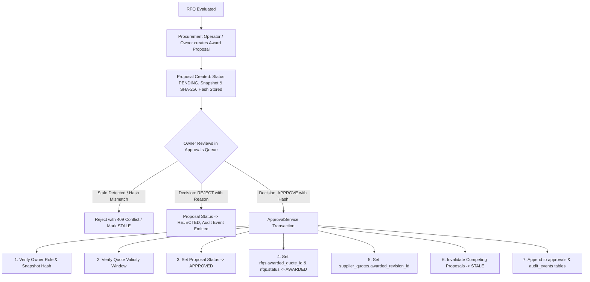
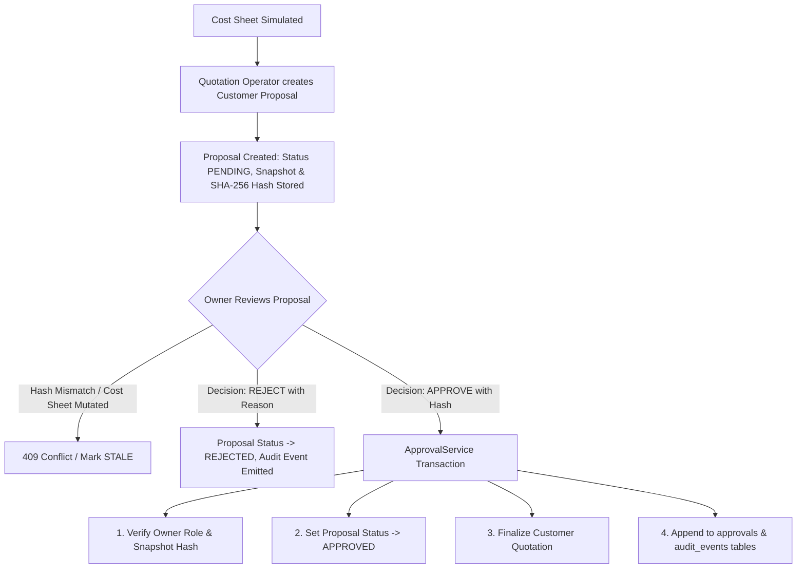

# MUNIM — Approval Workflow Architecture: Human Approval & Immutable Audit

**Document:** `docs/architecture/approval-workflow.md`  
**Version:** 1.0  
**Date:** 2026-11-18  
**Scope:** GAVS Problem Statement 4.1 — Commercial Approval & Audit Workflow  
**Authority:** PRD v1.1 (`docs/product/MUNIM_PRD_v1.1.md`), Section 11, 15, 16, 17, 19  

---

## 1. Executive Principle: Sole Commercial State Writer

In MUNIM, **no AI agent, ordinary user, or general API endpoint may directly award a supplier or approve a customer quotation.**

All commercial commitments are strictly governed by human approval:
- **`ApprovalService`** is the **sole writer** authorized to transition commercial proposals into `APPROVED` or `REJECTED` states, update `rfqs.awarded_quote_id`, and set `supplier_quotes.awarded_revision_id`.
- Controllers and workflow tasks cannot bypass `ApprovalService`.
- Every commercial transition must be executed within an ACID database transaction alongside an immutable `audit_events` entry and an append-only `approvals` record.

---

## 2. Approval Lifecycles

### 2.1 Supplier Award Lifecycle

#### Step-by-Step Flow:
1. **Prerequisites:** An RFQ exists in `OPEN` or `EVALUATED` status, with an evaluation record containing an eligible quote revision.
2. **Proposal Request:** The procurement operator or owner submits a request to create an award proposal for a chosen quote revision:
   - Endpoint: `POST /api/v1/evaluations/{evaluationId}/award-proposals`
   - Payload: `{ quoteRevisionId, expectedSnapshotHash }`
3. **Snapshot Capture:** The service generates an immutable JSONB payload containing:
   - RFQ specification, quantity, unit, and required procurement deadline.
   - Supplier name and ID.
   - Quote revision number, raw message hash, and structured commercial fields (unit price, tax rate, ITC status, freight basis, promised delivery date, validity window).
   - Evaluated landed cost components (`materialBase`, `materialGst`, `freightBase`, `freightGst`, `economicLandedCost`, `cashPayable`).
   - Active policy version.
4. **Stable Hashing:** Canonical SHA-256 is computed over the snapshot payload. The proposal is persisted with state `PENDING`.
5. **Review Queue:** The owner retrieves pending proposals via `GET /api/v1/approvals?status=PENDING` or `GET /api/v1/approvals/{id}`.
6. **Decision:** The owner submits the decision via `POST /api/v1/proposals/{id}/decision`:
   - Payload: `{ decision: "APPROVE" | "REJECT", reason, expectedSnapshotHash }`
7. **Validation & Atomic Execution:**
   - Authorization: Verified server-side (`OWNER` role required; 403 Forbidden otherwise).
   - Freshness & Hash Match: `expectedSnapshotHash` must match the proposal's stored `snapshot_hash` (409 Conflict otherwise).
   - Current State: Proposal must be in `PENDING` status (409 Conflict if already decided or stale).
   - Quote Validity: Current timestamp must be within `valid_from` and `valid_until` of the quote (422 Unprocessable Entity if expired).
   - If `APPROVE`:
     - Updates `commercial_proposals` to `APPROVED`.
     - Sets `rfqs.awarded_quote_id` and `rfqs.status = 'AWARDED'`.
     - Sets `supplier_quotes.awarded_revision_id`.
     - Marks any other pending proposals for the same RFQ as `STALE` with reason `"COMPETING_SUPPLIER_AWARDED"`.
   - If `REJECT`:
     - Requires a non-blank decision reason.
     - Updates `commercial_proposals` to `REJECTED` and stores `decision_reason`.
     - Leaves RFQ and supplier quote unawarded.
   - Audit Event: Writes an immutable record to `audit_events` and appends to `approvals`.

---

### 2.2 Customer Quotation Approval Lifecycle

1. **Prerequisites:** A customer enquiry cost sheet exists with resolved cost inputs (linked to an evaluated/awarded purchase price basis).
2. **Proposal Request:** Quotation operator or owner creates quote proposal:
   - Endpoint: `POST /api/v1/cost-sheets/{costSheetId}/quote-proposals`
   - Payload: `{ expectedVersion, sellingPrice, validUntil }`
3. **Snapshot & Hash:** Immutable snapshot records total cost, selling price, profit, margin percentage, markup percentage, cost components, and policy limits.
4. **Owner Decision:** Owner inspects and decides via `POST /api/v1/proposals/{id}/decision`.
5. **State Transition:** Only `ApprovalService` transitions proposal to `APPROVED` or `REJECTED`.

---

## 3. State Models & Enums

### 3.1 Proposal Status Enum (`commercial_proposals.status`)
Strictly matches PRD v1.1:
- `PENDING`: Proposal created, awaiting owner decision.
- `APPROVED`: Proposal approved by authorized owner via `ApprovalService`.
- `REJECTED`: Proposal rejected by authorized owner with documented reason.
- `STALE`: Proposal invalidated because underlying inputs (quote revision, evaluation, cost sheet, or owner policy) changed or a competing supplier was awarded.

### 3.2 Decision Action Enum (`DecisionCreate.decision`)
- `APPROVE`: Authorize the commercial proposal.
- `REJECT`: Decline the commercial proposal (requires `reason`).

### 3.3 Audit Action Enum (`audit_events.action`)
- `PROPOSAL_CREATED`: When a new commercial proposal is submitted.
- `PROPOSAL_DECIDED`: When the owner records an approval or rejection.
- `PROPOSAL_STALED`: When a proposal is automatically invalidated due to dependency mutations.
- `SUPPLIER_AWARDED`: When the RFQ and quote award links are committed.

---

## 4. Stale Proposal Detection & Concurrency Control

A proposal becomes **stale** under any of the following conditions:
1. **Snapshot Hash Mismatch:** The caller provides an `expectedSnapshotHash` that differs from the persisted hash at decision time. Result: `409 Conflict (STATE_CONFLICT: Proposal snapshot hash mismatch)`.
2. **State Transition Race:** Two concurrent requests attempt to decide the same proposal. Managed via database row locking (`SELECT ... FOR UPDATE` or optimistic locking on `commercial_proposals.version`). Only the first transition succeeds; subsequent attempts receive `409 Conflict`.
3. **Competing Award:** When an award proposal for RFQ \(X\) is approved, all other `PENDING` proposals referencing RFQ \(X\) are automatically updated to `status = 'STALE'` with `invalidation_reason = 'COMPETING_SUPPLIER_AWARDED'` and `invalidated_at = now()`.
4. **Underlying Quote/Evaluation Modification:** If an evaluation or quote revision is superseded, the dependent proposal is marked `STALE`.

---

## 5. Audit Trail & Immutability Guarantees

1. **`approvals` Table:**
   - Append-only. Every decision creates a new record.
   - No `UPDATE` or `DELETE` endpoints exist for this table.
2. **`audit_events` Table:**
   - Append-only.
   - Captures `actor_id`, `actor_role`, `action`, `entity_type`, `entity_id`, `before_hash`, `after_hash`, `reason`, `metadata`, and `occurred_at`.
   - Cannot be modified or deleted through ordinary application APIs.
3. **Snapshots:**
   - Stored in PostgreSQL `JSONB` format as read-only representations.
   - SHA-256 hash guarantees detection of any tampering.
