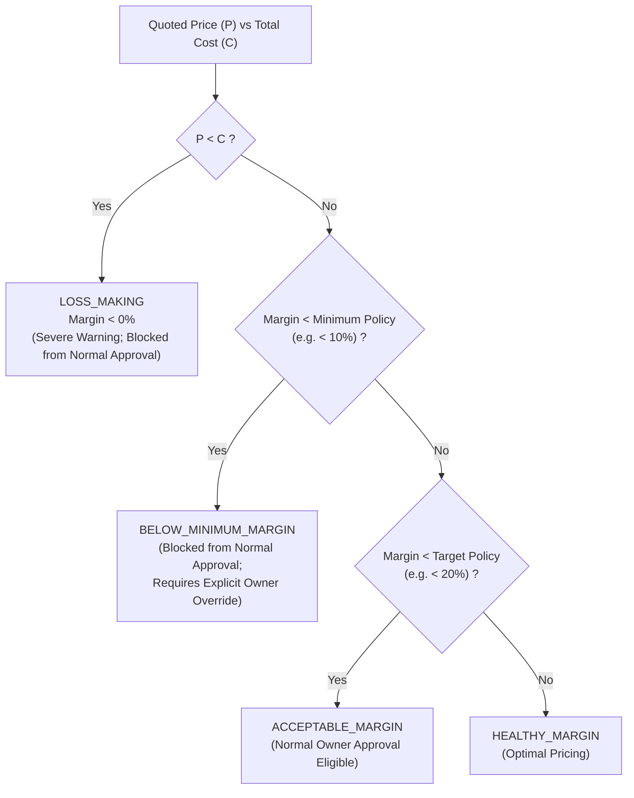

# MUNIM — Profitability & Customer Quotation Financial Rules

**Document:** `docs/financial/profitability-rules.md`  
**Date:** 2026-11-18  
**Scope:** GAVS Hackathon PS 4.1 — Profitability Intelligence & Customer Quotation Costing Engine  
**Authority:** Official PS 4.1 Specification  

---

## 1. Overview & Architectural Boundaries

MUNIM's core workflow operates across three continuous pillars:

$$\text{BUY SMARTER (Phases 2-5)} \longrightarrow \text{CALCULATE ACCURATELY (Phase 6)} \longrightarrow \text{QUOTE PROFITABLY (Phase 6)}$$

### Guiding Principles
1. **Deterministic Java First:**
   All financial formulas, conversions, cost summations, and margin percentages are executed in Java using `java.math.BigDecimal` with explicit scale and `RoundingMode.HALF_UP`. No LLM or AI agent performs arithmetic.
2. **Input Tax Credit (ITC) Tax Accounting:**
   In Indian GST accounting, if the fabricator is eligible for Input Tax Credit (`materialItcStatus == CREDITABLE`), input GST paid on steel or freight is **NOT** a cost of production. It is an offset against output GST liability. Charging recoverable input GST as a production cost artificially inflates prices and ruins quote competitiveness.
3. **Explicit Inbound Cost Attribution:**
   BOM material items must link directly to an **awarded supplier quote** (from Phase 4/5) or an explicit **owner estimate** (`ESTIMATED` status) with documented rationale.
4. **Policy-Enforced Margin Guardrails:**
   Customer quotations are categorized deterministically into margin tiers. Quotes below policy minimums cannot be approved through normal workflows and require explicit owner override justifications.

---

## 2. Mathematical Definitions & Financial Formulas

All monetary values are calculated in INR ($\text{₹}$) and represented as strings rounded to 2 decimal places in API outputs. All quantities are maintained to 4 decimal places.

### 2.1 Raw Material Cost ($C_{mat}$)

For a given BOM line item with net finished part weight $Q_{net}$ (in kg) and scrap wastage percentage $s_{scrap} \ge 0$:

1. **Gross Material Required ($Q_{gross}$):**
   $$Q_{gross} = Q_{net} \times \left(1 + \frac{s_{scrap}}{100}\right)$$

2. **Effective Material Unit Cost ($P_{mat\_unit}$):**
   $$P_{mat\_unit} = \begin{cases} 
   P_{inbound\_base} & \text{if } \text{ITC is CREDITABLE (Standard)} \\ 
   P_{inbound\_base} \times \left(1 + \frac{GST_{inbound\_rate}}{100}\right) & \text{if } \text{ITC is NON\_CREDITABLE} 
   \end{cases}$$

3. **Gross Material Cost ($C_{mat\_gross}$):**
   $$C_{mat\_gross} = Q_{gross} \times P_{mat\_unit}$$

4. **Scrap Recovery Credit ($C_{scrap\_credit}$):**
   If skeleton scrap is recoverable at market scrap rate $P_{scrap}$ per kg:
   $$Q_{scrap} = Q_{gross} - Q_{net}$$
   $$C_{scrap\_credit} = Q_{scrap} \times P_{scrap}$$

5. **Net Material Cost ($C_{mat\_net}$):**
   $$C_{mat\_net} = C_{mat\_gross} - C_{scrap\_credit}$$

---

### 2.2 Direct Labour & Conversion Cost ($C_{conversion}$)

Fabrication operations (e.g. CNC Turret Punching, Fiber Laser Cutting, CNC Press Brake Bending, MIG/TIG Welding, Powder Coating) incur setup, machine, and labour expenses:

For each operation $i$ across batch quantity $B \ge 1$:

1. **Setup Cost per Part ($C_{setup, i}$):**
   $$C_{setup, i} = \frac{\text{Setup Hours}_i \times R_{setup, i}}{B}$$

2. **Machine Run Cost per Part ($C_{machine, i}$):**
   $$C_{machine, i} = \text{Cycle Hours}_i \times R_{machine, i}$$

3. **Direct Labour Cost per Part ($C_{labour, i}$):**
   $$C_{labour, i} = \text{Labour Hours}_i \times R_{labour, i}$$

4. **Total Conversion Cost per Part ($C_{conversion}$):**
   $$C_{conversion} = \sum_{i=1}^{n} \left( C_{setup, i} + C_{machine, i} + C_{labour, i} \right)$$

---

### 2.3 Factory Overhead Cost ($C_{overhead}$)

Factory overhead (utilities, facility rent, tooling depreciation, supervision) is allocated as an overhead absorption rate $k_{ovh}$ applied to direct conversion:

$$C_{overhead} = C_{conversion} \times k_{ovh}$$

---

### 2.4 Outbound Packaging & Delivery ($C_{freight}$)

$$C_{logistics} = C_{packaging\_per\_part} + C_{outbound\_freight\_per\_part}$$

---

### 2.5 Total Production Cost ($C_{total}$)

The total economic unit cost of production is:

$$C_{total} = C_{mat\_net} + C_{conversion} + C_{overhead} + C_{logistics}$$

For an order batch of size $B$, the total batch cost is:
$$C_{batch\_total} = C_{total} \times B$$

---

## 3. Selling Price & Margin Calculations

### 3.1 Target Selling Price ($P_{target}$)

Given a desired gross target profit margin $m_{target} \in [0, 1)$ (e.g. $0.20$ for $20\%$):

$$P_{target} = \frac{C_{total}}{1 - m_{target}}$$

> **Important Accounting Clarification:**
> - **Margin** is calculated on the **Selling Price**: $\text{Margin} = \frac{P - C}{P}$.
> - **Markup** is calculated on the **Cost**: $\text{Markup} = \frac{P - C}{C}$.
> - MUNIM standardizes strictly on **Margin** to ensure consistency across commercial quotations and financial audits.

### 3.2 Realized Margin ($m_{realized}$)

For any proposed or quoted selling price $P_{quoted}$:

$$\text{Gross Profit} = P_{quoted} - C_{total}$$
$$m_{realized} = \frac{P_{quoted} - C_{total}}{P_{quoted}} \times 100\%$$

### 3.3 Output GST & Customer Cash Payable

Selling price $P_{quoted}$ is strictly **exclusive** of customer output GST. Output GST is calculated and billed on the commercial quotation:

$$\text{Output GST} = P_{quoted} \times \frac{GST_{output\_rate}}{100}$$
$$\text{Customer Invoice Total} = P_{quoted} + \text{Output GST}$$

---

## 4. Policy Guardrails & Margin Status Classification

Every calculated quotation is classified into one of four deterministic policy statuses:

| Margin Tier | Margin Range ($m$) | Approval Workflow Behavior | Policy Guard |
|---|---|---|---|
| **`HEALTHY_MARGIN`** | $m \ge m_{target}$ (e.g. $\ge 20\%$) | Eligible for standard Owner approval. | None. Optimal commercial health. |
| **`ACCEPTABLE_MARGIN`** | $m_{min} \le m < m_{target}$ (e.g. $10\% \le m < 20\%$) | Eligible for standard Owner approval. | Informational notice on margin discount. |
| **`BELOW_MINIMUM_MARGIN`** | $0\% \le m < m_{min}$ (e.g. $0\% \le m < 10\%$) | **Blocked from standard approval.** | Requires explicit `overrideBelowMinimumMargin = true` with mandatory documented `overrideReason`. |
| **`LOSS_MAKING`** | $m < 0\%$ ($P_{quoted} < C_{total}$) | **Hard blocked from standard approval.** | Extreme commercial warning. Prohibits ordinary release. |

---

## 5. Customer Quotation Approval Workflow Integration

Phase 6 extends [`ApprovalService`](file:///Users/gopalguptamac/Downloads/GAVS-MUNIM/backend/src/main/java/org/munim/approval/ApprovalService.java) without weakening Phase 4 supplier award boundaries:

1. **New Proposal Type:** `CUSTOMER_QUOTATION`
2. **Immutable Proposal Snapshot:**
   - Customer enquiry identity & deadline.
   - Complete BOM structure with inbound cost links.
   - Costing breakdown snapshot ($C_{mat}, C_{conv}, C_{ovh}, C_{frt}, C_{total}$).
   - Quoted base price, output GST, customer total.
   - Target margin %, realized margin %, and policy tier.
   - Underlying quote validity dates.
   - Canonical SHA-256 snapshot hash.
3. **Sole Commercial Writer Rule:**
   - Only an authenticated `OWNER` can approve customer quotations.
   - Evaluators or operators cannot approve quotes or bypass margin overrides.
4. **Stale Proposal Invalidation:**
   - If an awarded supplier quote revision changes, or the quotation validity window expires, the pending proposal transitions to `STALE` and cannot be committed.
