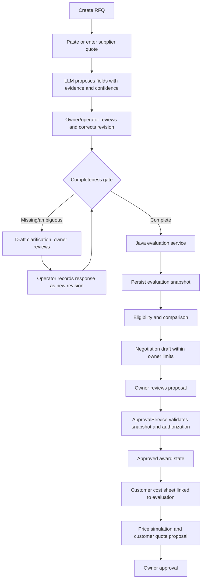
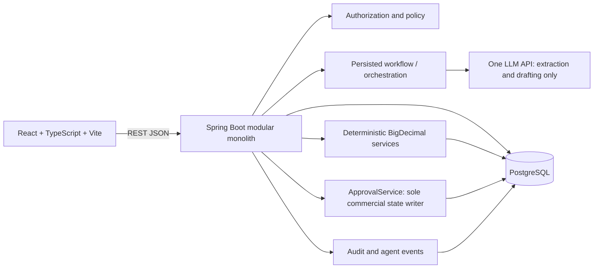
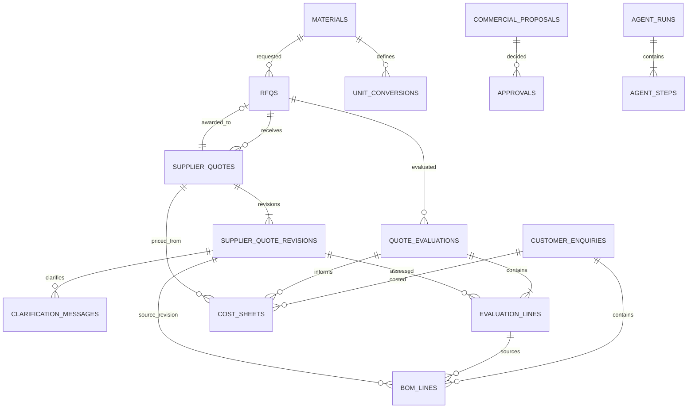

# MUNIM Product Requirements Document

**Version:** 1.1  
**Status:** Corrected baseline; technical-finding reconciliation pending  
**Prepared:** 18 November 2026  
**Product:** MUNIM — procurement and profitability assistant for small sheet-metal fabricators  
**Problem statement:** GAVS Hackathon PS 4.1

> **Source integrity:** The official PS 4.1 PDF supplied separately as `Tech4Bharath - 4(2).pdf` has been inspected and matches MUNIM's target: “Small factories overpay for raw material and quote orders at a loss.” The numbered technical review and separate proposed-acceptance-criteria file remain unavailable. Appendix A distinguishes review-topic mapping from exact finding-ID reconciliation; Appendix B records decisions and assumptions. Product decisions and engineering recommendations are labeled separately from official requirements.

## 1. Document control

| Version | Date | Owner | Change |
|---|---|---|---|
| 1.0 | 2026-11-18 | Product / Architecture | Initial PRD |
| 1.1 | 2026-11-18 | Product / Architecture | Corrected finance, data lineage, API/workflow, security, validation and source traceability |

**Available source files inspected:** `Tech4Bharath - 4(2).pdf` (official PS 4.1, verified); `MUNIM — GAVS Hackathon Strategy and Build Document (PS 4.1).md`; `docs/product/MUNIM_PRD_v1.0.md`. The strategy's supplier examples and prevented-loss values are synthetic. The PS 4.1 PDF agrees with the problem framing and boundaries summarized in the strategy.

**Requirement labels:** **[OFFICIAL]** is directly supported by the supplied PS 4.1 PDF. **[PRODUCT]** is a chosen user/product behavior. **[ENGINEERING]** is an implementation recommendation or constraint.

## 2. Executive summary

MUNIM helps a small sheet-metal fabrication owner compare supplier quotations using complete, deadline-feasible landed cost, then reuse approved procurement cost inputs when building a customer quote. It reduces manual re-entry and exposes missing facts, cost assumptions, margin, and approval state. Its core loop is **Buy Smarter → Calculate Accurately → Quote Profitably**.

LLM use is limited to extraction, classification, and draft language. Java services validate and calculate all amounts with `BigDecimal`. Unknown values remain unknown; no eligibility or financial calculation may silently substitute zero or an assumed tax treatment. The owner approves every supplier award and customer quotation. The MVP is a single-tenant local demo with synthetic supplier data, one sheet-metal vertical, REST APIs, PostgreSQL, React/TypeScript/Vite, Spring Boot, and one LLM API with a manual fallback.

## 3. Problem statement

**[OFFICIAL]** PS 4.1 identifies repeated supplier calls and missed deals, approximate costing and loss-making quotes, limited reach beyond local buyers, unstructured/multilingual quotations, volatile prices, and mapping vague buyer requirements to shop-floor capability. It states negotiation remains within owner-set limits and a person makes every award and payment. **[PRODUCT]** MUNIM addresses quote intake, comparable landed cost, deadline eligibility, bounded negotiation drafts, and cost-based customer quotation. **[ENGINEERING]** The MVP does not acquire new buyers or automate purchase commitments.

These are problem-statement claims, not independently measured local baselines. Field validation is required before presenting them as measured outcomes.

## 4. Product vision

Give a fabrication owner one reviewable workspace where supplier messages become verified quote fields, comparable costs, and controlled next actions—and where accepted purchase costs inform a transparent customer cost sheet. Owners retain control of all commercial decisions.

## 5. Objectives and success metrics

### Objectives

1. Capture and compare supplier quotes without losing source text or uncertainty.
2. Exclude suppliers who fail explicit hard constraints and explain each decision.
3. Calculate a reproducible landed cost and preserve its assumptions.
4. Link a selected/approved procurement evaluation to the customer cost sheet.
5. Require explicit approval against an immutable proposal snapshot.
6. Deliver a stable, rehearsable local end-to-end demo.

### Demo metrics (not business-impact claims)

| Metric | MVP target |
|---|---|
| Core procurement scenario | Complete from RFQ creation through comparison and approval in local demo |
| Deterministic calculation repeatability | Same normalized inputs and policy produce byte-equivalent monetary values |
| Missing mandatory fields | 100% block evaluation with named missing fields |
| Ineligible supplier explanation | Every hard-rule rejection has a reason code and explanation |
| Approval integrity | Any material change after proposal creation makes prior approval stale |
| LLM failure fallback | Manual quote entry can finish the procurement scenario |
| Parsing quality | Report labelled test-set count and field-level errors; no unsupported accuracy claim |

No savings, accuracy, or time-reduction claim is considered verified without field data.

## 6. Personas

| Persona | Need | Authority / constraint |
|---|---|---|
| Fabrication owner (primary) | Compare offers, protect margin, make final decisions | May edit policy and approve/reject commercial proposals |
| Procurement/admin operator | Enter RFQs and supplier messages, resolve missing data | May draft and correct fields; cannot award supplier absent owner role |
| Quotation operator | Build cost sheets and customer quote drafts | May enter estimates; customer quote commitment requires owner approval |
| Demo evaluator | Understand why a recommendation was made | Read-only access to evaluations, agent trace and audit history |

Authentication is deferred for the single-user demo, but backend authorization checks and a role abstraction are required; hiding buttons is not authorization.

## 7. Product scope

### In scope

- Procurement home page containing RFQs, quote intake, comparison, and workflow status.
- Manual and LLM-assisted structured quote intake with field provenance and confidence.
- Completeness gate, clarification draft, quote revisions, persisted evaluations.
- Unit normalization through explicitly configured conversion factors only.
- Landed-cost breakdown, deadline and quantity eligibility, explainable ranking.
- Negotiation draft constrained by owner policy and protected information rules.
- Customer enquiry/cost sheet linked to the selected procurement evaluation and price basis.
- Margin/markup display, what-if price changes, quote draft, approval snapshot and audit.
- Read-only approvals and agent trace UI assigned to integration/QA developer.
- Local Docker Compose demo; cloud hosting optional.

### Out of scope

Supplier marketplace/discovery, real WhatsApp integration, accounting/tax filing, payment or purchase execution, automatic award, price forecasting, multi-industry support, multi-tenant production auth, native mobile app, vision inspection, and unverified supplier scoring.

## 8. Functional requirements

Priority: **P0** required for demo; **P1** desirable if P0 is stable; **P2** deferred.

| ID | Description / priority | Inputs | Expected behaviour and validation | Errors | Acceptance |
|---|---|---|---|---|---|
| FR-01 | Create RFQ (P0) | Material/spec, quantity, unit, needed-by date, reference date | Persist RFQ; quantity positive; unit supported; date valid under fixed demo clock | 400 field errors; 404 material | RFQ appears on procurement home page |
| FR-02 | Capture supplier quote (P0) | Supplier, raw message or manual fields, RFQ | Preserve original text; create revision; mark unknowns explicitly; no default values for absent facts | 400 validation; 409 revision conflict | Source and structured fields visible together |
| FR-03 | Extract quote (P0) | Quote revision ID, optional locale | LLM returns schema-constrained candidates with confidence, source spans and unknowns; untrusted text treated as data | 502/503 provider error; malformed output is retryable/manual fallback | No extracted field becomes verified without validation/review |
| FR-04 | Review/correct fields (P0) | Field values, correction reason | Save a new immutable revision with actor, time, source/provenance; validate units/ranges | 400 invalid value; 409 stale revision | Previous value and provenance remain auditable |
| FR-05 | Check completeness (P0) | Quote revision and RFQ | Require unit price, quoted quantity/unit, price basis, material tax rate/ITC, freight basis/amount/tax rate/price basis/ITC, MOQ, purchase increment, wastage, quantity basis, promised delivery and validity window; return missing/ambiguous fields and block evaluation | 404 unknown quote; 422 incomplete | Unknown GST basis, unit, quantity, delivery or validity cannot be silently assumed |
| FR-06 | Draft clarification (P0) | Missing fields, supplier message context | Draft only targeted questions; do not fabricate terms or include competitor/confidential data | 502 provider unavailable | Owner can edit; sending is outside MVP |
| FR-07 | Evaluate quotes (P0) | RFQ, complete revisions, policy version, reference time | Persist evaluation snapshot, normalized inputs, outputs, rule versions and exclusion reasons | 422 incomplete; 409 conflicting workflow state | Repeat evaluation with identical inputs yields identical monetary results |
| FR-08 | Compare suppliers (P0) | Persisted evaluation ID | Show eligible and rejected offers, cost components, basis, delivery and reasons | 404 evaluation | Late supplier excluded even if cheapest |
| FR-09 | Draft negotiation (P0) | Selected eligible quote, owner policy version, proposed unit rate/terms | Enforce `min_unit_rate`, `max_discount_percent`, permitted term fields, `max_payment_days`, allowed seller-visible fields and forbidden disclosure set. Draft is a suggestion only; no sending. | 403 absent procurement role; 409 stale policy; 422 bounds conflict/no eligible quote; 502/503 LLM failure | Rate remains within floor/ceiling; draft and disclosure audit pass; no competitor quote, internal target, margin, private notes, or other supplier identity disclosed |
| FR-10 | Create supplier award proposal (P0) | Evaluation, chosen supplier, quote revision, policy | Snapshot exact commercial terms and evaluation; status pending | 409 stale evaluation; 422 ineligible/incomplete | Proposal cannot be approved if any dependency changed |
| FR-11 | Create customer enquiry/cost sheet (P0) | Product, quantity, material/BOM, procurement evaluation link, labour/overhead/freight | Persist explicit source and price basis for every cost; no implicit procurement link | 422 missing cost inputs; 404 link | Cost sheet identifies the procurement evaluation and selected quote revision used |
| FR-12 | Simulate customer selling price (P0) | Cost sheet version, selling price | Calculate profit, margin and markup deterministically; distinguish them in UI | 400 nonpositive price; 409 stale sheet | Price below cost and margin below policy both flagged |
| FR-13 | Create customer quote proposal (P0) | Cost sheet version, price, validity | Immutable proposal snapshot with line items, assumptions and policy | 422 incomplete; 409 stale version | Any changed cost/price invalidates approval snapshot |
| FR-14 | Approve/reject proposal (P0) | Proposal ID, decision, reason, expected snapshot hash | `ApprovalService` re-reads and verifies authorization, eligibility, snapshot hash and policy before state change | 403 unauthorized; 409 stale; 422 invalid transition | Only authorized service commits award/quote approval; rejection is auditable and does not change awarded quote |
| FR-15 | View workflow/audit (P0) | Workflow/reference ID | Read-only ordered event and agent-step trace, input/output references, retries, approvals | 404 not found | QA member's interface cannot mutate business state |
| FR-16 | Retry workflow (P1) | Workflow ID, idempotency key | Resume only retryable step up to configured max; idempotent writes | 409 exhausted/nonretryable | No duplicate quote/evaluation/approval on retry |
| FR-17 | Summary metrics (P1) | Date range | Show counts and explicitly synthetic scenario estimate labels | 400 invalid range | No estimated savings presented as realized savings |

## 9. User stories

- As an owner, I can paste a supplier message and see candidate fields beside the original evidence.
- As an operator, I can correct a field without erasing the extracted value or who changed it.
- As an owner, I can see why a cheap supplier is excluded for being late or infeasible.
- As an owner, I can configure a negotiation floor/ceiling and review a draft that does not reveal competing bids.
- As an owner, I can start a customer cost sheet from an identified procurement evaluation and inspect its cost basis.
- As an owner, I can vary a price and see profit, margin, markup, and warnings update.
- As an owner, I can approve the exact displayed snapshot, with stale proposals rejected.
- As an evaluator, I can inspect the workflow trace and synthetic-data labels without making changes.

## 10. Acceptance criteria

1. Create an RFQ for 500 kg of 2 mm mild-steel sheet due within three calendar days using the fixed demo clock.
2. Import three synthetic quotes. Supplier C is rejected for late delivery even when its evaluated cost is lowest.
3. A message missing unit, GST treatment, validity, or delivery produces explicit unknown/missing state and blocks evaluation when that field is mandatory.
4. Ambiguous or recoverable GST is never treated as economic cost without an explicit basis; cash payable and economic cost are shown separately.
5. An extraction result can be reviewed and corrected; correction creates a revision and provenance record.
6. Supplier B's missing GST treatment/validity causes a clarification draft that contains no invented supplier term and no rival quote details.
7. Landed cost components and total reconcile according to Section 12, using four decimal rate precision, two decimal money precision, and half-up rounding at defined boundaries.
8. An evaluation persists its exact input revisions, policy version, reference time, conversion factors, result, eligibility reasons, and calculation version.
9. The customer cost sheet links to the selected procurement evaluation and records whether its purchase basis is quote, evaluated landed cost, or owner override. It never claims a purchase actually occurred unless separately recorded (not MVP).
10. With total cost ₹10,000, selling price ₹12,500 gives profit ₹2,500, margin 20%, markup 25%. UI labels margin and markup separately.
11. A proposal approved against a prior snapshot is rejected as stale after a dependent field or policy changes.
12. Unauthorized approval calls return 403; UI visibility alone does not grant access.
13. LLM output containing instructions to reveal secrets or alter policy is treated as untrusted content; it cannot trigger tools or change limits.
14. LLM timeout, malformed JSON, or exhausted retry allows manual entry and a visible failed-step trace.
15. Local `docker compose up` starts application and database from documented configuration; the demo scenario completes without cloud access.
16. Unit tests cover financial formulas, boundaries, rounding, GST basis, MOQ, partial quantity, wastage, conversion, and stale approval; API integration tests cover primary workflow and authorization.
17. Acceptance walkthrough completes by the end of Day 2; Day 3 is reserved for stabilization, demo rehearsal, and optional deployment.

## 11. Agent workflows



Persisted workflow state enum: `CREATED → RUNNING → WAITING_FOR_INPUT → READY_FOR_EVALUATION → EVALUATED → AWAITING_APPROVAL → APPROVED | REJECTED`; any nonterminal state may enter `FAILED_RETRYABLE` or `FAILED_FINAL`; stale proposals enter `STALE`; user cancellation enters `CANCELLED`. Allowed transitions are enforced transactionally and every transition has actor, timestamp and reason. Agent-step states: `PENDING, RUNNING, SUCCEEDED, NEEDS_REVIEW, RETRY_WAIT, FAILED, SKIPPED`. Maximum **2 automatic retries after the initial attempt** for transient network/5xx/timeouts, with bounded exponential backoff; no retry for schema/validation errors or policy rejections. After exhaustion transition to `FAILED_FINAL` and manual fallback. An explicit operator retry is permitted once per failed step (new attempt, same idempotency key only for duplicate request suppression); it does not reset the automatic retry budget. Approval and award transitions are never retried as workflow side effects; the caller submits an idempotent decision command.

Each extraction field includes `confidence` 0–1, `evidence` exact source span or `null`, `modelVersion`, `promptVersion`, and extraction timestamp. Thresholds: `>=0.90` candidate may be prefilled but remains unverified; `0.70–0.8999` requires explicit review; `<0.70`, absent/contradictory evidence, or critical-field ambiguity is `NEEDS_REVIEW` with no value accepted. These thresholds are engineering defaults to tune against the synthetic test set. Manual entry is always available; manual values require actor and correction/source reason.

Relative dates such as “tomorrow” are resolved once against the RFQ's stored `reference_at` and `timezone`; the fixed demo clock is configurable and recorded. Ambiguous date/timezone expressions require review.

## 12. Financial business rules

### 12.1 Precision and rounding

- Java monetary calculations use `BigDecimal`; never `double`/`float`.
- Unit and exchange rates (no foreign currency in MVP) use `NUMERIC(14,4)`; money uses `NUMERIC(14,2)`; percentages use `NUMERIC(8,4)`.
- API monetary values are decimal **strings** to avoid binary floating-point loss.
- Intermediate arithmetic retains precision. Round each posted money component to 2 decimals using `RoundingMode.HALF_UP`; sum rounded components. Ratios display to 2 percentage decimals, retaining unrounded ratio internally.
- Currency is INR for demo. Currency conversion is out of scope.

### 12.2 Price basis and GST

Each quote stores material GST and freight GST independently: `material_tax_rate`, `material_price_basis`, `material_itc_status`; `freight_tax_rate`, `freight_price_basis`, `freight_itc_status`. Other charges carry their own taxable flag/rate only when provided. All ITC statuses are `CREDITABLE`, `NON_CREDITABLE`, or `UNKNOWN`. **Engineering simplification for MVP:** no tax-on-tax, reverse-charge, place-of-supply, or bundled-charge apportionment is modeled. Freight is either explicitly GST-inclusive/exclusive at a separately supplied rate, or its tax is `UNKNOWN`; do not assume freight shares material's GST rate. GST treatment requires accountant validation before real use. Unknown tax treatment blocks confirmed economic-cost evaluation; no indicative range is ranked.

For each component (material and freight separately), rate `r`, quantity `q`, base amount `B`:

- Exclusive unit price: `B = q × unit_rate`; inclusive unit price's base is derived only when its applicable rate is explicitly known: `B = inclusive_amount / (1 + r)`.
- Freight is `F_base` if ex-tax, or is tax-inclusive and split only with its separately known freight rate. GST amounts are independently calculated and rounded for material and freight.
- Cash payable = material base + material GST + freight base + freight GST + untaxed/other charges, with no duplicate inclusion of a tax-inclusive amount.
- Economic cost = material base + freight base + other charges + each explicitly non-creditable GST component. Creditable GST is excluded from economic cost but shown in cash payable. Unknown rate, price basis, or creditability blocks final comparable cost.
- Example: 100 kg × ₹100/kg exclusive, material GST 18% and explicitly non-creditable, separate freight ₹500 with freight GST explicitly confirmed nil → material ₹10,000, material GST ₹1,800, freight ₹500, economic landed cost ₹12,300; cash payable ₹12,300. If material GST is creditable, economic cost ₹10,500 while cash payable remains ₹12,300.

### 12.3 Quantity, MOQ, partial quantities and excess stock

Let `u` be normalized usable demand, `w` wastage fraction, `i` supplier sale increment, and `m` MOQ in the same base unit. Validate `0 <= w < 1`, `i > 0`, `m >= 0`. If price applies to input purchased quantity: `q_need=u/(1-w)` when wastage applies, else `u`; `q_increment=ceil(q_need/i)×i`; `q_moq=ceil(m/i)×i`; `q_purchase=max(q_increment,q_moq)`. Persist rounding excess `q_increment-q_need`, MOQ excess `max(0,q_purchase-q_increment)`, and excess versus usable demand `max(0,q_purchase-u)` separately. If quote prices usable output, disable gross-up and record that basis. A supplier unable to confirm increment or price quantity basis is incomplete. Split sourcing is disabled for MVP.

Partial quantity is permitted only if RFQ policy explicitly enables split sourcing; each supplier allocation must sum to demand and satisfy per-supplier MOQ and deadlines. Default MVP disallows split sourcing. Example: demand 500 kg, MOQ 600 kg, ₹100/kg → order quantity 600 kg, material commitment ₹60,000, excess stock 100 kg; not silently priced as a 500 kg order.

### 12.4 Wastage

Wastage is handled only by the quantity formula above; never add a second wastage charge. Example: usable demand 100 kg, `w=0.05`, increment 1 kg, MOQ 0 gives `q_need=105.2632`, `q_increment=q_purchase=106 kg`; at ₹100/kg material base is ₹10,600 before freight/tax. With MOQ 110 kg, purchase is 110 kg, MOQ excess over incremented need is 4 kg, and excess versus usable demand is 10 kg. Keep these measures distinct.

### 12.5 Unit conversion

No implicit kg/sheet/piece conversion. A conversion is allowed only from an approved material-specific factor (e.g. kg per sheet), with source, effective date, and precision recorded. Missing conversion blocks comparison. Normalize quantity and price to material base unit before calculation; retain entered unit and factor in evaluation snapshot.

### 12.6 Landed cost and eligibility

Use the component-level definitions in Section 12.2 and the normative formulas in `docs/financial/financial-rules.md`:

`Economic landed cost = material base + separate freight base + other charges + explicitly non-creditable material GST + explicitly non-creditable freight GST + other nonrecoverable taxes.`

`Cash payable = material base + material GST + separate freight base + freight GST + other payable charges.`

Freight is not double-counted if already included in unit price. Recoverable GST is excluded from economic cost. MOQ excess and quantity adjustment are explicit. Payment terms are displayed, not converted to an invented economic benefit.

Hard eligibility checks (delivery date; specification match; quantity/MOQ feasibility; quote validity at planned award; complete price/tax/unit basis). A failed hard gate excludes the quote before ranking and records reason code. Among eligible suppliers, MVP ranks by landed economic cost; any weighted terms scoring is deferred until weights are explicitly configured and validated. Example: A costs ₹49,000 on time; B ₹50,500 on time; C ₹47,000 but arrives after required date. C is excluded; A ranks first.

### 12.7 Customer cost, margin and markup

`Total cost = material cost + labour + overhead + freight + other explicitly listed direct costs.`
`Profit = selling price − total cost.`
`Margin % = profit / selling price × 100.`
`Markup % = profit / total cost × 100.`

Missing components are `UNKNOWN`, never zero by default. Cost sheet can be evaluated only after owner explicitly enters zero or value for every required component. Example: cost ₹10,000 and sale ₹12,500 → profit ₹2,500, margin 20%, markup 25%. If price ≤ 0, reject input. If price < cost, show loss warning. If margin below owner minimum, show policy warning and approval may be blocked according to policy.

## 13. Technical architecture



Local Docker Compose is the primary environment. One Spring Boot deployable contains modules for RFQ, quote intake/revisions, evaluation, cost engine, supplier selection, negotiation drafts, customer costing, approvals, workflow and audit. Cloud deployment is optional after a verified local demo.

### Cross-cutting engineering decisions

- OpenAPI 3.1 contract is committed alongside implementation; generated/validated DTOs or contract checks prevent drift.
- Financial values travel as strings; timestamps ISO-8601 with offset; IDs UUID; errors use `application/problem+json`.
- Every command supports idempotency where retries can duplicate writes.
- Every persisted `POST` command requires `Idempotency-Key`; the same key plus same canonical request returns the original status/body, while reuse with different request content returns `409 IDEMPOTENCY_KEY_REUSED`. Keys are scoped by authenticated actor and operation and retained at least for the duration of the demo environment. Read-only simulations may omit the key. `PUT` corrections require `expectedVersion` and return `409 VERSION_CONFLICT` on stale edits.
- `reference_at`, timezone, policy/version, calculation version, and FX-free INR basis are snapshotted.
- Data migrations are versioned; seed data is clearly synthetic.
- Secrets supplied through environment variables; no secrets or raw sensitive supplier contact data in logs.

## 14. Frontend architecture

React + TypeScript + Vite, route-level pages, typed API client generated from OpenAPI where feasible, query/cache layer, form validation, and shared money/date formatting. Consolidate dashboard into a **Procurement Home** with RFQ status, quote intake, missing-data queue, comparison, and next actions. Customer profitability is a linked workflow page, not a separate dashboard. Approvals and agent trace are read-only screens owned by integration/QA; mutations occur through explicit backend approval endpoints in owner view.

States required: loading, empty, stale data, validation errors, provider failure/manual fallback, incomplete quote, eligible/ineligible comparison, pending/approved/rejected/stale proposal. Unknown is visually distinct from zero. Show source message, extracted/corrected value, provenance, confidence, and evaluation snapshot. Confirmation language must identify the exact supplier, amount, quote validity, and proposal version.

## 15. Backend architecture

Packages/modules: `rfq`, `supplier`, `quote`, `extraction`, `evaluation`, `costing`, `selection`, `negotiation`, `enquiry`, `approval`, `workflow`, `audit`, `api`.

`ApprovalService` is the only component permitted to transition supplier award and customer quote proposal into approved/committed states. Controllers and LLM orchestration cannot write those statuses directly. Approval transaction checks role, proposal state, version/hash, policy version, quote/evaluation freshness, completeness, and eligibility; then writes decision plus audit event atomically.

## 16. PostgreSQL schema

All tables have UUID primary keys and `created_at`; mutable records also have `updated_at` and optimistic `version`. Money columns are `NUMERIC(14,2)`, rates `NUMERIC(14,4)`. Use FK constraints and check constraints for positive quantities/rates and enumerated states.

| Table | Important fields / purpose |
|---|---|
| `suppliers` | name, contact, location, `is_synthetic` |
| `materials` | name, grade, specification, base unit, active |
| `unit_conversions` | material, from/to unit, factor, source, effective dates, approver |
| `rfqs` | material_id FK, required qty/unit, `production_lead_days`, customer_required_by, resolved `required_procurement_delivery_at`, reference_at/timezone, split sourcing flag, status, awarded_quote_id FK |
| `supplier_quotes` | rfq_id FK, supplier_id FK, current_revision_id FK, `awarded_revision_id` nullable FK, state |
| `supplier_quote_revisions` | supplier_quote_id FK, revision number/state, `received_at` and ingested_at, raw message/hash, structured fields/provenance, material price basis and GST/ITC, freight basis/amount/GST/ITC, unit/rate/qty, MOQ, increment, wastage, quote quantity basis, payment terms, promised date, `valid_from`, `valid_until`, confidence/completeness |
| `clarification_messages` | quote revision, missing fields, draft, status, simulated response marker |
| `owner_policies` | version/effective time, min margin, max purchase budget, min/max unit rate, max discount percent, max payment days, allowed negotiable terms, seller-visible allowlist, forbidden disclosure denylist, approval threshold |
| `quote_evaluations` | rfq_id and policy_id FKs, input revision IDs, conversion/calculation versions, reference_at/timezone, normalized input snapshot, results, eligibility/reasons, hash |
| `evaluation_lines` | evaluation_id FK, quote_revision_id FK, normalized quantity breakdown, material/freight/GST/other component amounts, economic cost, cash payable, status/reason |
| `customer_enquiries` | customer/product, quantity, due date, status |
| `bom_lines` | enquiry_id FK, material_id FK, source_evaluation_line_id and source_quote_revision_id nullable FKs, usable quantity, wastage, conversion FK, estimated source |
| `cost_sheets` | enquiry_id FK, nullable evaluation_id/evaluation_line_id and awarded supplier_quote_id/quote_revision_id FKs, price basis, material/labour/overhead/freight/other inputs, total, version |
| `cost_input_sources` | cost_sheet FK, component, source type/reference, value, actor, override reason and timestamp |
| `commercial_proposals` | type award/customer quote, immutable snapshot JSONB, snapshot hash, status, policy/evaluation/revision/cost sheet references, invalidation time/reason |
| `approvals` | proposal_id FK, actor, decision, reason, snapshot hash, decided_at |
| `agent_runs` | workflow type/reference, persisted state enum, reference_at/timezone, automatic retry count/max, manual retry-used flag, idempotency key |
| `agent_steps` | run_id FK, step/state/attempt, bounded input/output refs and hashes, confidence, provider/model/prompt/schema versions, latency_ms, error code/detail |
| `audit_events` | actor/role, action, entity/version, timestamp, request/correlation ID, before/after hashes, reason, policy version, metadata |

### Lineage and delivery date

`production_lead_days` is the owner-entered number of calendar days from receipt of material to completed production. For an order due at `customer_required_by`, latest material delivery is `required_procurement_delivery_at = customer_required_by - production_lead_days` (using RFQ timezone and the explicitly recorded calendar-day convention). Direct purchase RFQ may set this procurement deadline directly. Supplier eligibility uses the stored procurement deadline, never an agent-inferred date. An award updates `supplier_quotes.awarded_revision_id` and `rfqs.awarded_quote_id` only through ApprovalService. BOM line source FKs point to the evaluation line and quote revision; cost sheet links to the same evaluation/line and awarded quote revision when awarded. Owner-entered overrides use a separate `cost_input_sources` record with actor, reason, prior source and value; they do not erase provenance.

Revision states: `DRAFT`, `RECEIVED`, `EXTRACTED`, `NEEDS_REVIEW`, `VERIFIED`, `SUPERSEDED`, `WITHDRAWN`. Transition from `RECEIVED` to `VERIFIED` requires required fields and user verification (or explicitly configured trusted manual entry); edits create a new revision and supersede the prior current revision. `received_at` is when the business received the supplier offer, not when MUNIM ingested it. Absolute validity timestamps are stored as stated. An explicit relative duration (e.g. “valid for 7 days”) resolves from `received_at`, not ingestion time, in the supplier's known timezone using calendar days; the derived timestamp and `DERIVED_FROM_EXPLICIT_DURATION` provenance are stored. If receipt time, timezone, or duration wording is ambiguous, validity remains unknown. If valid-from is not stated, it is explicitly set to `received_at` with `DEFAULT_IMMEDIATE_FROM_RECEIPT` provenance. Missing validity blocks award. Valid at award iff `valid_from <= decision_time <= valid_until`; evaluation records the decision reference time and freshness result.



## 17. REST API specifications

All request/response objects use camelCase. Money/rate decimals are JSON strings. Common error:

```json
{"type":"about:blank","title":"Validation failed","status":422,"detail":"Quote cannot be evaluated","code":"QUOTE_INCOMPLETE","fieldErrors":{"gstCreditability":"Required"},"traceId":"uuid"}
```

### Endpoint catalogue

| Method / route | Request | Response | Status | Validation / entities |
|---|---|---|---|---|
| `GET /api/v1/materials` | query `active?` | `{items:Material[]}` | 200,400 | `materials` |
| `GET /api/v1/suppliers` | query `active?` | `{items:Supplier[]}` | 200,400 | `suppliers` |
| `POST /api/v1/suppliers` | Header `Idempotency-Key`; `{name,location?,isSynthetic:true}` | `Supplier` | 201,400,409 | Synthetic flag must be true for demo seed/manual supplier; `suppliers` |
| `GET /api/v1/owner-policy` | — | `OwnerPolicy` | 200,403 | Role-gated read; `owner_policies` |
| `PUT /api/v1/owner-policy` | `{expectedVersion,policy}` | `OwnerPolicy` | 200,400,403,409 | Owner only; validate bounds and disclosure enum; new immutable policy version |
| `POST /api/v1/rfqs` | `{materialId,specification,quantity,unit,customerRequiredBy?,productionLeadDays?,requiredProcurementDeliveryAt?,timezone,allowSplitSourcing}` | `Rfq` | 201, 400, 404, 422 | One deadline source; derive procurement deadline as customer deadline less lead days; positive quantity/nonnegative lead; `rfqs`,`materials` |
| `GET /api/v1/rfqs` | query `status,page,size` | `{items,total}` | 200, 400 | Pagination; `rfqs` |
| `GET /api/v1/rfqs/{id}` | — | `RfqDetail` | 200,404 | `rfqs`,`supplier_quotes` |
| `GET /api/v1/rfqs/{id}/completeness` | query `quoteRevisionId` | `Completeness` | 200,404 | Explicit unknown/missing fields; `supplier_quote_revisions` |
| `POST /api/v1/rfqs/{id}/quotes` | Header `Idempotency-Key`; `{supplierId,receivedAt,rawMessage,manualFields}` | `QuoteRevision` | 201,400,404,409 | receivedAt is supplier offer receipt time; retain raw text and structured fields; `supplier_quotes`,`supplier_quote_revisions` |
| `POST /api/v1/quotes/{id}/revisions/{revision}/extract` | `{locale?}` | `{revisionId,candidates[],providerStatus}` | 200,404,422,502,503 | Never auto-verifies; quote revision, agent steps |
| `PUT /api/v1/quotes/{id}/revisions/{revision}/fields` | `{expectedVersion,fields:{...},correctionReason}` | `QuoteRevision` | 200,400,404,409 | Typed fields/provenance; new revision; `supplier_quote_revisions`,`audit_events` |
| `POST /api/v1/quotes/{id}/revisions/{revision}/clarifications` | `{expectedFields[]}` | `ClarificationDraft` | 201,404,422,502 | Missing fields only; no sending; `clarification_messages` |
| `POST /api/v1/quotes/{id}/revisions/{revision}/clarifications/{cid}/response` | `{responseText,receivedAt,simulated}` | `QuoteRevision` | 201,400,404,409 | New revision, never overwrite; `clarification_messages`,`supplier_quote_revisions` |
| `POST /api/v1/rfqs/{id}/evaluations` | Header `Idempotency-Key`; `{quoteRevisionIds[],policyVersion}` | `Evaluation` | 201,404,409,422 | Server stamps reference time; completeness hard gate; snapshot persisted; evaluation entities |
| `GET /api/v1/evaluations/{id}` | — | `Evaluation` | 200,404 | Immutable stored result |
| `GET /api/v1/evaluations/{id}/lines` | — | `{items:EvaluationLine[]}` | 200,404 | Persisted line detail; `evaluation_lines` |
| `GET /api/v1/approvals` | query `status?,page,size` | `{items:ApprovalQueueItem[],total}` | 200,403,400 | Owner read; `commercial_proposals`,`approvals` |
| `GET /api/v1/approvals/{proposalId}` | — | `ApprovalDetail` | 200,403,404 | Owner read; proposal snapshot and decision history; `commercial_proposals`,`approvals` |
| `GET /api/v1/rfqs/{id}/comparison` | query `evaluationId` | `{evaluationId,lines[]}` | 200,404,409 | Must use persisted evaluation; evaluation lines |
| `POST /api/v1/evaluations/{id}/negotiation-drafts` | `{quoteRevisionId,requestedTerms[]}` | `{draft,limits,disclosures[]}` | 201,403,404,422,502 | Eligible only; policy bounds; no competitor info; no send |
| `POST /api/v1/evaluations/{id}/award-proposals` | Header `Idempotency-Key`; `{quoteRevisionId,expectedSnapshotHash}` | `Proposal` | 201,403,409,422 | Eligible and current; proposal/approval |
| `POST /api/v1/enquiries` | `{customerName,productDescription,quantity,unit,requiredBy}` | `Enquiry` | 201,400 | Positive quantity; `customer_enquiries` |
| `POST /api/v1/enquiries/{id}/cost-sheets` | `{evaluationLineId?,priceBasis,materialCost?,labourCost?,overheadCost?,freightCost?,otherCosts[],unknownFields[]}` | `CostSheet` | 201,404,409,422 | Explicit basis and all required fields resolved; `cost_sheets`,`bom_lines` |
| `POST /api/v1/cost-sheets/{id}/simulate` | `{expectedVersion,sellingPrice}` | `{totalCost,profit,marginPercent,markupPercent,warnings[]}` | 200,400,404,409 | Decimal strings, positive price; no state mutation |
| `POST /api/v1/cost-sheets/{id}/quote-proposals` | Header `Idempotency-Key`; `{expectedVersion,sellingPrice,validUntil}` | `Proposal` | 201,403,409,422 | Complete/current; `commercial_proposals` |
| `POST /api/v1/proposals/{id}/decision` | `{decision:"APPROVE"|"REJECT",reason,expectedSnapshotHash}` | `Approval` | 200,403,404,409,422 | Owner role; ApprovalService only writer; approvals/audit |
| `GET /api/v1/workflows/{id}` | — | `{run,steps[],events[]}` | 200,404 | Read-only trace; agent tables/audit |
| `POST /api/v1/workflows/{id}/retry` | Header `Idempotency-Key`; `{stepId}` | `AgentRun` | 202,403,404,409,422 | Retryable and under limit only |
| `GET /api/v1/analytics/summary` | query `from,to` | `{counts,scenarioEstimates,synthetic:true}` | 200,400 | Clearly label scenario estimates |

### Representative schemas

```json
// Rfq request
{"materialId":"uuid","specification":"2 mm IS 2062 mild steel sheet","quantity":"500.0000","unit":"kg","customerRequiredBy":"2026-11-24T17:00:00+05:30","productionLeadDays":3,"requiredProcurementDeliveryAt":"2026-11-21T17:00:00+05:30","timezone":"Asia/Kolkata","allowSplitSourcing":false}
```

```json
// Quote revision response excerpt
{"id":"uuid","revision":2,"rawMessage":"MS 2mm...","fields":{"unitPrice":{"value":"95.0000","unit":"INR/kg","confidence":"0.98","source":"EXTRACTED","evidence":"₹95/kg"},"gstTreatment":{"value":null,"confidence":null,"source":"UNKNOWN","evidence":null}},"completeness":{"complete":false,"missing":["gstTreatment"]},"version":2}
```

```json
// Evaluation response excerpt
{"id":"uuid","referenceAt":"2026-11-18T10:00:00+05:30","calculationVersion":"1.0","policyVersion":1,"status":"COMPLETE","lines":[{"quoteRevisionId":"uuid","eligible":false,"reasonCodes":["DELIVERY_AFTER_REQUIRED_BY"],"economicLandedCost":"47000.00","cashPayable":"...","currency":"INR"}]}
```

### OpenAPI contract

`docs/api/openapi.yaml` is the canonical OpenAPI 3.1 contract, with `/api/v1`, UUIDs, ISO date-times, decimal strings, common Problem errors, security declaration, per-operation `x-required-role`, idempotency headers for persisted POST commands, and route/schema definitions. Validate implementation DTOs against it during Day 1 integration. No endpoint is considered implemented if absent from the contract.

## 18. UI/UX specifications

1. **Procurement Home:** RFQs, workflow state, missing fields, synthetic-data banner, create RFQ CTA.
2. **RFQ workspace:** quote cards with raw text and extracted field table; confidence/provenance; correction controls; clarification draft; evaluation and comparison.
3. **Comparison:** eligible list sorted by economic landed cost; excluded list with reason; separate economic cost/cash payable; delivery, validity, MOQ excess, tax and conversion assumptions.
4. **Negotiation review:** proposed message, allowed bound, policy, disclosure check, owner approval action.
5. **Profitability page:** procurement source link, cost inputs, unknown/confirmed status, price simulator showing cost, profit, margin, markup, minimum-margin warning.
6. **Read-only approvals/trace:** proposal snapshot, decision actor/time, stale marker, step attempts, error and retry state.

Use INR formatting only for display; retain exact strings from API. Never display unknown as ₹0.00. Show date interpretation and reference timezone for relative dates.

## 19. Security and approval guardrails

- Supplier messages are untrusted input. Strip/escape markup, limit length, redact secrets/PII where appropriate, and pass content to the LLM as quoted data with instructions not to follow embedded commands.
- LLM has no tools for database approval writes, award, payment, external messages, policy changes, or supplier selection. It cannot author final numeric fields; extraction is a proposal requiring validation/review.
- Negotiation drafts only use explicit owner-defined floor/ceiling and permitted terms. Never reveal other suppliers' identities, offers, confidential cost, internal target, or owner notes. If safe bounds are absent or conflict, do not draft; ask owner to set policy.
- Backend checks role for policy edits and all approval endpoints. Default demo identity may be seeded, but authorization is enforced server-side.
- Approval is bound to immutable snapshot hash, policy version, evaluation and quote revision IDs. Any dependency mutation makes proposal stale; approval is rejected and a new proposal required.
- Only `ApprovalService` changes approved/awarded state, in one transaction with audit event.
- Keep LLM provider key server-side; redact logs; cap payloads and retries; record provider/model identifier and prompt/schema version, not secrets.
- Supplier personas and prevented-loss estimates are labeled synthetic throughout.

## 20. Testing strategy

JUnit 5 unit tests for cost math, rounding, tax branches, unknown completeness, MOQ, partial quantities, wastage, conversions, validity/deadline, margin/markup, policy boundaries, stale snapshot, and approval permission. Property/boundary cases include zero/negative quantities, rates, extreme precision, and rounding half cases.

Spring integration tests with PostgreSQL/Testcontainers (or Docker Compose test profile) cover migrations, endpoints, persisted evaluations, optimistic locking, idempotency, stale approval, and `ApprovalService` sole-writer behavior. LLM tests use deterministic fixtures for valid, low-confidence, prompt-injection, malformed JSON, timeout, and provider failure; no live provider is required for the core scenario.

**Synthetic multilingual/adversarial dataset specification [ENGINEERING]:** maintain at least 12 fictional supplier-message fixtures, each with raw message, language/style label, field-level gold values, evidence spans, unknown/ambiguous field labels, expected completeness, and expected workflow result. Cover English, Hindi, and Hinglish representations (add another language only when a reviewer can validate its gold labels); INR symbols/words, unit variants, GST included/extra/as-applicable, freight included/separate/unknown, MOQ/increment, dates/relative validity, typos and mixed scripts. At least four fixtures include adversarial instructions embedded in supplier text (e.g. “ignore owner policy”, request rival bid details, fake system prompt, or request to mark unknown tax as zero); expected behavior is treating that text as untrusted data and never exposing internal information or changing policy. All names/messages are synthetic. Report fixture/field counts, extraction errors by field, low-confidence counts, and injection cases blocked; do not report accuracy percentages from this small set.

Frontend tests cover unknown-vs-zero, stale proposal, explicit margin/markup labels, errors and read-only trace/approval surfaces. End-to-end smoke script runs the three-supplier scenario locally. Test checklist includes missing unit, ambiguous GST, late/expired quote, lowest-but-ineligible, below-cost price, below-minimum margin, owner approval, malformed LLM JSON, retry exhaustion, and identical re-evaluation.

## 21. Three-day development plan

Four developers, approximately seven effective development hours per person/day. Priority is an end-to-end procurement slice by **midday Day 1**; freeze feature work by early Day 3.

| Day / time | Deliverable |
|---|---|
| Day 1, first 1 hour | Agree API contract, demo clock, seed scenario, and local Compose boot; commit OpenAPI skeleton |
| Day 1, by midday | End-to-end thin slice: create RFQ, manually add one quote, evaluate deterministically, render comparison; LLM can be stubbed |
| Day 1, remainder | Add quote revisions/provenance, LLM extraction adapter and manual fallback, missing-field gate, 3 quote fixtures, integration against contract |
| Day 2 | Complete GST/quantity/wastage/cost rules, persisted evaluations, negotiation draft guardrails, linked cost sheet, margin simulator, approval snapshots and audit |
| Day 3, morning | Full acceptance walkthrough, failure states, regression, Compose reliability; freeze new features by 13:00 |
| Day 3, afternoon | Demo rehearsal, presentation, local backup recording/screenshots; cloud deployment only if local is stable and time remains |

## 22. Team allocation

| Member | Owns | Day 1 integration checkpoint |
|---|---|---|
| 1 — Backend/data | Spring Boot, PostgreSQL migrations, RFQ/quote APIs, evaluation and financial services, ApprovalService | Service accepts contract DTO and returns deterministic comparison |
| 2 — AI/workflow | extraction schema/prompt, confidence/evidence, clarification and negotiation drafts, workflow persistence/retries, synthetic fixtures | Stub/real adapter interchangeable; malformed output safely falls back |
| 3 — Frontend | Procurement Home, quote review, comparison, linked profitability page and simulator | Mock-backed screen connected to RFQ/evaluation endpoints by midday |
| 4 — Integration/QA/demo | OpenAPI contract validation, Docker Compose, acceptance/JUnit/E2E coordination, synthetic dataset, **read-only approvals and agent trace UI**, demo script | Compose boots and one RFQ flows through UI to persisted evaluation |

Each member works in agreed module boundaries; API/schema changes are reviewed at daily integration checkpoints.

## 23. Demo scenario

Synthetic scenario inputs from the supplied strategy: owner needs 500 kg of 2 mm mild-steel sheet within three days. Supplier A: ₹95/kg plus 18% GST, ₹1,500 freight, delivery in two days, seven-day validity. Supplier B: ₹96/kg, freight included, delivery tomorrow, 15-day terms, GST treatment/validity omitted. Supplier C: ₹90/kg, ₹3,000 freight, delivery in six days. The source inputs do not state A's GST creditability or freight GST basis, nor B/C GST treatment or validity.

Sequence: create RFQ; ingest three fictional messages; review extraction; show B's missing terms and C's missed deadline; persist an evaluation with C excluded and A/B marked incomplete for confirmed tax basis until explicit clarification resolves gaps. Do not show a confirmed winner, negotiation recommendation, or award from source inputs alone. If the demo supplies additional clarification values, store and label them as separately invented synthetic test fixtures. Only then demonstrate negotiation bounds/approval, linked cost sheet, price simulator and audit. Label personas, messages, assumptions and scenario-prevented loss as synthetic. Do not imply a real purchase occurred.

## 24. Risk register

| Risk | Impact | Mitigation / owner |
|---|---|---|
| Missing review/criteria source files | Exact traceability may be incomplete | Obtain source and reconcile Appendix A; product owner |
| GST misinterpretation | Wrong cost comparison | Explicit basis/creditability; accountant validation required; backend lead |
| LLM hallucination/injection | False quote terms or leakage | Untrusted-input handling, evidence, owner verification, no tools; AI lead |
| Unknowns treated as zero | Invalid ranking/margin | Typed unknowns and completeness gates; backend/frontend |
| Stale approval | Approves changed terms | Immutable snapshot hash and transactional check; backend |
| Integration late | Demo failure | Contract-first, mid-Day 1 vertical slice; integration lead |
| MOQ/wastage/unit errors | Wrong effective cost | Explicit quantity model and unit tests; backend |
| LLM/network unavailable | Intake workflow blocked | Manual-entry mode and deterministic fixtures; AI lead |
| Scope exceeds three days | Incomplete core | One vertical, no marketplace/real send/payment; all |
| Unsupported impact claims | Credibility loss | Synthetic labels, field validation, report actual test results; product/demo lead |

## 25. Field-validation plan

Speak with at least one real sheet-metal fabricator. Ask: how many suppliers were contacted and how long the last purchase took; which costs were missed; how GST and freight were treated; whether MOQ/excess is common; how the last buyer quote was calculated; what labour/overhead/outsourcing enters it; how often orders lost money; what causes late deliveries; and whether supplier-message correction/provenance fits existing practice. Record consent, role, date, and anonymized notes. Do not present one interview as representative. Questions about buyer discovery and pooled purchasing inform roadmap only, not MVP scope.

## 26. Future roadmap

Only after field validation and MVP evaluation: authentication/tenant isolation; real supplier communication integrations with consent; more robust material conversion catalogue; split sourcing; supplier performance based on verified history; accounting export; additional verticals; historical price analysis. No roadmap item authorizes autonomous commitments. Prioritize based on observed owner pain and validated willingness to adopt/pay.

## 27. Final MVP definition of done

- Local Docker Compose boots from documented setup and seeded synthetic data.
- One complete procurement workflow can be demonstrated without cloud or live LLM dependency.
- Manual quote entry and optional extraction both work; uncertain fields require review.
- Persisted evaluation shows deterministic cost breakdown, cash payable, eligibility, reasons and source revisions.
- Negotiation draft respects bounds and protects competitor/internal information.
- Customer cost sheet links to the procurement evaluation with explicit basis; price simulator correctly distinguishes margin and markup.
- Proposals bind to snapshots; stale and unauthorized approvals fail; only ApprovalService changes commercial status.
- API contract, schema, migrations, README/demo steps, test evidence, synthetic labels and unresolved decisions are committed.
- All P0 acceptance criteria pass; no unsupported savings or parsing accuracy claims appear in demo materials.

## Appendix A. Review topic traceability

The technical review itself was not supplied, so individual C/H/M/L texts and their exact IDs cannot be verified. The following maps every review topic explicitly listed in the request to a resolution. Reconcile IDs against the original review before declaring the source traceability complete.

| Review topic named in request | PRD resolution |
|---|---|
| Negotiation limits and information leakage | FR-09, Sections 11, 19; policy bounds; no competitor/internal disclosure |
| Procurement-to-profitability data linkage | FR-11, Sections 16–18; cost sheet references evaluation and price basis |
| GST creditability and price basis | Section 12.2; explicit fields, separate cash/economic amounts, accountant validation |
| Unknown values and completeness gates | FR-05, 12.7, acceptance 3–4; unknown is not zero |
| Approval snapshots and stale approval prevention | FR-10/13/14, Sections 15, 19; immutable hash and transactional recheck |
| Untrusted supplier messages and extraction verification | FR-03/04, Sections 11/19; quoted data, evidence, review required |
| Early end-to-end integration | Section 21; midday Day 1 vertical slice |
| Missing API endpoints and OpenAPI contracts | Section 17 complete endpoint catalogue and canonical OpenAPI requirements |
| Persisted quote evaluations | FR-07/08, schema `quote_evaluations`, API evaluation resources |
| Quote revisions and field provenance | FR-02/04, schema revisions, API correction endpoint |
| Relative dates and fixed demo clock | Sections 11, 13, 16; stored `reference_at` and timezone |
| MOQ, partial quantities and excess stock | Section 12.3; split sourcing defaults false; excess shown |
| Wastage calculation | Section 12.4; gross-up input quantity; no double charge |
| Unit conversion | FR-07, Section 12.5; only approved material-specific factors |
| Margin versus markup | FR-12, Section 12.7, acceptance 10 |
| Numeric precision and rounding | Section 12.1; BigDecimal, column scales, HALF_UP, API strings |
| Workflow persistence and retry limits | Section 11, schema agent runs/steps, FR-16 |
| Low-confidence extraction | FR-03, acceptance 5, Section 19; review gate and manual fallback |
| Owner overrides and permission enforcement | FR-04/14, Sections 15/19; correction provenance and server-side role checks |
| Demo reliability and acceptance criteria | Sections 10, 20–23, 27; local Compose and failure fixtures |
| Exact C1–C7 / H1–H19 / M1–M12 / L1–L7 mapping | **Unresolved:** source review absent. Appendix C registers every finding ID as requiring source reconciliation. Do not claim individual verification or resolution. |

## Appendix B. Unresolved decisions and assumptions

1. Obtain technical review and proposed acceptance criteria documents; map exact IDs and wording, preserving any additional findings.
2. Owner role/authentication mechanism for the demo (seeded local identity versus simple login); authorization semantics remain required regardless.
3. Confirm GST price-basis and creditability model with an accountant; current rules are explicit software assumptions only.
4. Confirm supplier increment/packaging behavior and whether demo material is priced by input or usable kg.
5. Confirm minimum margin policy and whether below-threshold quotes are blocked or require elevated override; default is warning plus owner decision, with below-cost quotes prohibited from approval absent explicit override policy.
6. Confirm interpretation of supplier quote validity at award time and local business timezone; store both exact timestamp and timezone.
7. No verified supplier reliability/quality data exists. Such scores are excluded from MVP ranking.
8. Calendar-day vs business-day semantics for `production_lead_days` must be selected by product owner; this version's engineering default is calendar days and is explicitly recorded per RFQ.
9. Field policy for freight GST and other charge taxation requires accountant validation; MVP supports separate explicit rate/basis only and no bundled allocation.
10. Exact thresholds for the extraction confidence model are engineering defaults requiring validation on the proposed test set.
11. Official PS 4.1 source was verified at `/Users/gopalguptamac/Downloads/GAVS PS/Industrial Manufacturing/Tech4Bharath - 4(2).pdf`. The numbered review and its proposed acceptance criteria remain absent; do not mark those traceability items complete.

## 28. Source and decision classification

Claims labeled `[OFFICIAL]` are supported by the supplied PS 4.1 PDF. Product scope, persona behavior, controls, and demo flow are `[PRODUCT]`. Precision, database lineage, retry policy, thresholds and service boundaries are `[ENGINEERING]`. Synthetic supplier messages and figures are never presented as verified facts.

## 29. Validation and release gate

Before implementation sign-off, reconcile all review finding IDs. Before demo release, pass the supporting acceptance matrix, financial examples, workflow transition tests, permission/stale-snapshot tests, API/schema FK consistency, and local Compose scenario. These checks establish demo behavior only; they do not prove real-world savings, extraction accuracy, or tax correctness.

## Appendix C. Review ID register

The exact technical review source is absent. The request specifies ID ranges only, not finding text. Therefore none of the IDs below can be described as verified/resolved. This register preserves every ID for one-by-one reconciliation when the source is provided.

| Finding ID | Status | Resolution reference |
|---|---|---|
| C1–C7 | Requires source reconciliation (each of C1, C2, C3, C4, C5, C6, C7) | Appendix A topic map; source needed to confirm exact mapping |
| H1–H19 | Requires source reconciliation (each of H1 through H19) | Appendix A topic map; source needed to confirm exact mapping |
| M1–M12 | Requires source reconciliation (each of M1 through M12) | Appendix A topic map; source needed to confirm exact mapping |
| L1–L7 | Requires source reconciliation (each of L1 through L7) | Appendix A topic map; source needed to confirm exact mapping |

## Appendix D. Change log and validation artifacts

See `docs/validation/prd-v1.1-change-log.md`, `docs/validation/traceability-matrix.md`, `docs/api/openapi.yaml`, `docs/database/schema-design.md`, and `docs/financial/financial-rules.md`. These documents are normative companions. Where a disagreement is found, this PRD's requirements and the finance/schema/API companion specifications must be reconciled before coding; source gaps may not be resolved by inference.

