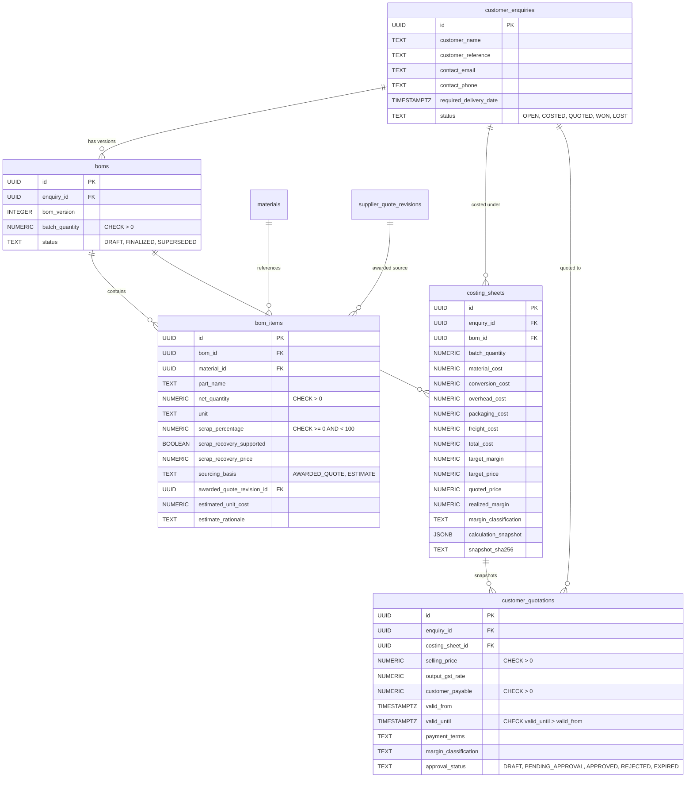

# MUNIM — Phase 6 Step 2 & 3 Completion Report: Database V4 & Deterministic Profitability Engine

**Document:** `docs/validation/phase-6-step-2-3-completion-report.md`  
**Date:** 2026-11-18  
**Scope:** GAVS Problem Statement 4.1 — Phase 6 Step 2 (Database Migration V4) & Step 3 (Deterministic Java Profitability Engine)  
**Status:** **FULLY IMPLEMENTED & VERIFIED AGAINST POSTGRESQL 17 (STEP 2 & 3 COMPLETE)**  
**Authority:** Official PS 4.1 Specification  

---

## 1. Executive Summary

Phase 6 implements the **"CALCULATE ACCURATELY"** and core calculation layer of **"QUOTE PROFITABLY"** for MUNIM, enabling small sheet-metal fabrication businesses to accurately establish true production costs, amortize batch tooling, adhere strictly to Indian GST Input Tax Credit (ITC) accounting, and categorize commercial quotations by profit margin health.

### Core Architecture & Guiding Principles
1. **Deterministic Java First:**
   - All financial formulas, conversions, cost summations, and margin percentages are executed in Java using `java.math.BigDecimal` with `RoundingMode.HALF_UP`.
   - No `double` or `float` floating-point types are used for monetary or rate mathematics.
   - Monetary amounts are scaled to 2 decimal places; quantities to 4 decimal places; margins to 2 decimal places.
2. **Indian GST Input Tax Credit (ITC) Accounting:**
   - When `itcStatus == CREDITABLE`, input GST paid on materials is **excluded** from the production cost basis because it constitutes an offset against output GST liability.
   - When `itcStatus == NON_CREDITABLE`, input GST is added to the material cost basis:
     $$P_{mat\_unit} = P_{inbound\_base} \times \left(1 + \frac{GST_{inbound\_rate}}{100}\right)$$
   - Quoted selling prices strictly exclude output GST; output GST is computed separately on the customer invoice.
3. **Explicit Inbound Cost Attribution & Sourcing Basis:**
   - Material line items strictly enforce either `AWARDED_QUOTE` (requiring `awarded_quote_revision_id` and null estimate fields) or `ESTIMATE` (requiring `estimated_unit_cost`, non-blank `estimate_rationale`, and null quote revision ID).
   - An estimated cost can never masquerade as an awarded supplier quote at both the Java validation layer and the PostgreSQL database constraint layer (`bom_items_sourcing_check`).
4. **Scrap Recovery Accounting:**
   - Gross material requirement accounts for skeleton and cutoff scrap: $Q_{gross} = Q_{net} \times (1 + \frac{s_{scrap}}{100})$.
   - If scrap recovery is supported, scrap credit ($Q_{scrap} \times P_{scrap}$) is credited against material cost. If unsupported, recovery price must be null.
5. **Direct Conversion & Setup Amortization:**
   - Batch setup costs are amortized over batch quantity: $C_{setup} = \frac{\text{Setup Hours} \times R_{setup}}{B}$.
   - Machine run and direct labour hours are calculated per part.
   - Factory overhead absorption is applied as a multiplier on direct conversion.
6. **Policy-Enforced Margin Guardrails:**
   - Every calculated quotation is deterministically classified:
     - `LOSS_MAKING`: Quoted price < Total production cost ($m < 0\%$).
     - `BELOW_MINIMUM_MARGIN`: Realized margin $\ge 0\%$ but $< m_{min}$ (e.g. $< 10\%$).
     - `ACCEPTABLE_MARGIN`: Realized margin $\ge m_{min}$ but $< m_{target}$ (e.g. $10\% \le m < 20\%$).
     - `HEALTHY_MARGIN`: Realized margin $\ge m_{target}$ (e.g. $\ge 20\%$).
7. **Snapshot Immutability & Audit Trail:**
   - Every calculation produces a canonical JSON snapshot with a SHA-256 digest for audit and commercial approval linkage.

---

## 2. Deliverables & Implementation Inventory

| Component | Artifact / File | Role & Verification | Status |
|---|---|---|---|
| **Database Migration V4** | [`V4__profitability_and_customer_quotes.sql`](file:///Users/gopalguptamac/Downloads/GAVS-MUNIM/backend/src/main/resources/db/migration/V4__profitability_and_customer_quotes.sql) | DDL for `customer_enquiries`, `boms`, `bom_items`, `costing_sheets`, and `customer_quotations` with composite checks. | **PASS** |
| **Clean Database Migration Test** | [`FlywayCleanDatabaseTest.java`](file:///Users/gopalguptamac/Downloads/GAVS-MUNIM/backend/src/test/java/org/munim/integration/FlywayCleanDatabaseTest.java) | Autonomous clean database test executing V1->V2->V3->V4 on fresh PostgreSQL, asserting 4 successful migrations and exactly 19 tables. | **PASS** |
| **Profitability DTOs** | [`ProfitabilityDtos.java`](file:///Users/gopalguptamac/Downloads/GAVS-MUNIM/backend/src/main/java/org/munim/profitability/ProfitabilityDtos.java) | Strongly typed immutable records for input costing requests, operations, BOM line items, and costing results. | **PASS** |
| **Validation Exception** | [`ProfitabilityValidationException.java`](file:///Users/gopalguptamac/Downloads/GAVS-MUNIM/backend/src/main/java/org/munim/profitability/ProfitabilityValidationException.java) | Standardized domain exception holding structured error codes and messages for invalid costing inputs. | **PASS** |
| **Profitability Engine** | [`ProfitabilityEngine.java`](file:///Users/gopalguptamac/Downloads/GAVS-MUNIM/backend/src/main/java/org/munim/profitability/ProfitabilityEngine.java) | `@Service` implementing deterministic costing, ITC tax treatment, scrap credit, setup amortization, margin tiers, and SHA-256 snapshotting. | **PASS** |
| **Engine Test Suite** | [`ProfitabilityEngineTest.java`](file:///Users/gopalguptamac/Downloads/GAVS-MUNIM/backend/src/test/java/org/munim/profitability/ProfitabilityEngineTest.java) | 24 JUnit 5 tests covering all 20 required financial scenarios + parameterized sheet-metal matrix. | **PASS** |
| **DB Integration Tests** | [`ProfitabilityDatabaseIntegrationTest.java`](file:///Users/gopalguptamac/Downloads/GAVS-MUNIM/backend/src/test/java/org/munim/integration/ProfitabilityDatabaseIntegrationTest.java) | 10 integration tests against PostgreSQL 17 verifying entity creation and CHECK constraints. | **PASS** |

---

## 3. Database Migration V4 Architecture & Schema Verification

Flyway migration `V4__profitability_and_customer_quotes.sql` introduces 5 new tables:



### PostgreSQL Table Verification
Total tables in PostgreSQL post-V4: **19 tables** (18 application tables + 1 `flyway_schema_history`):
1. `approvals`
2. `audit_events`
3. `bom_items`
4. `boms`
5. `clarification_messages`
6. `commercial_proposals`
7. `costing_sheets`
8. `customer_enquiries`
9. `customer_quotations`
10. `evaluation_lines`
11. `flyway_schema_history`
12. `idempotency_records`
13. `materials`
14. `quote_evaluations`
15. `quote_extractions`
16. `rfqs`
17. `supplier_quote_revisions`
18. `supplier_quotes`
19. `suppliers`

---

## 4. Deterministic Financial Verification: Golden Case

The standard fabrication golden scenario was verified with exact decimal precision:

### Inputs:
- **Batch Quantity:** 100 parts
- **BOM Item:** "Chassis Base Plate", $Q_{net} = 2.0000\text{ kg}$, Scrap = $10.00\%$, Scrap Recovery Supported = `true` @ $30.00\text{ ₹/kg}$.
- **Sourcing:** `AWARDED_QUOTE`, Unit Cost = $80.00\text{ ₹/kg}$, ITC = `CREDITABLE`, Inbound GST = $18.00\%$.
- **Operation 1 (Laser Cutting):** Setup = $1.00\text{ hr} @ 500.00\text{ ₹/hr}$; Cycle = $0.05\text{ hr} @ 600.00\text{ ₹/hr}$; Labour = $0.05\text{ hr} @ 200.00\text{ ₹/hr}$.
- **Operation 2 (CNC Bending):** Setup = $0.50\text{ hr} @ 400.00\text{ ₹/hr}$; Cycle = $0.08\text{ hr} @ 500.00\text{ ₹/hr}$; Labour = $0.08\text{ hr} @ 250.00\text{ ₹/hr}$.
- **Factory Overhead Multiplier:** $0.15$ ($15\%$ on conversion).
- **Logistics:** Packaging = $5.00\text{ ₹/part}$, Outbound Freight = $10.00\text{ ₹/part}$.
- **Margin Policy:** Target = $20.00\%$ ($0.20$), Minimum = $10.00\%$ ($0.10$).
- **Quoted Price:** $400.00\text{ ₹/part}$, Output GST = $18.00\%$.

### Step-by-Step Mathematical Trace:

| Cost Element | Formula | Expected Calculation | Engine Result | Status |
|---|---|---|---|---|
| Gross Material Qty | $Q_{net} \times (1 + s_{scrap}/100)$ | $2.0000 \times 1.10$ | `2.2000 kg` | **EXACT** |
| Scrap Qty | $Q_{gross} - Q_{net}$ | $2.2000 - 2.0000$ | `0.2000 kg` | **EXACT** |
| Effective Material Price | Recoverable ITC = Base | $80.00$ (input GST excluded) | `80.00 ₹` | **EXACT** |
| Gross Material Cost | $Q_{gross} \times P_{mat}$ | $2.2000 \times 80.00$ | `176.00 ₹` | **EXACT** |
| Scrap Credit | $Q_{scrap} \times P_{scrap}$ | $0.2000 \times 30.00$ | `6.00 ₹` | **EXACT** |
| Net Material Cost | Gross Cost - Scrap Credit | $176.00 - 6.00$ | `170.00 ₹` | **EXACT** |
| Laser Cutting Cost | $(500.00/100) + 30.00 + 10.00$ | $5.00 + 30.00 + 10.00$ | `45.00 ₹` | **EXACT** |
| CNC Bending Cost | $(200.00/100) + 40.00 + 20.00$ | $2.00 + 40.00 + 20.00$ | `62.00 ₹` | **EXACT** |
| Total Conversion Cost | Laser + Bending | $45.00 + 62.00$ | `107.00 ₹` | **EXACT** |
| Factory Overhead | $107.00 \times 0.15$ | $16.05$ | `16.05 ₹` | **EXACT** |
| Logistics Cost | Packaging + Outbound Freight | $5.00 + 10.00$ | `15.00 ₹` | **EXACT** |
| **Total Cost per Part** | $170.00 + 107.00 + 16.05 + 15.00$ | $308.05$ | `308.05 ₹` | **EXACT** |
| Total Batch Cost | $308.05 \times 100$ | $30,805.00$ | `30,805.00 ₹` | **EXACT** |
| Target Selling Price | $308.05 / (1 - 0.20)$ | $308.05 / 0.80 = 385.0625$ | `385.06 ₹` | **EXACT** |
| Gross Profit per Part | $400.00 - 308.05$ | $91.95$ | `91.95 ₹` | **EXACT** |
| Realized Margin % | $(91.95 / 400.00) \times 100$ | $22.9875\%$ | `22.99 %` | **EXACT** |
| Margin Classification | $22.99\% \ge 20.00\%$ | `HEALTHY_MARGIN` | `HEALTHY_MARGIN` | **EXACT** |
| Output GST (18%) | $400.00 \times 0.18$ | $72.00$ | `72.00 ₹` | **EXACT** |
| Customer Payable | $400.00 + 72.00$ | $472.00$ | `472.00 ₹` | **EXACT** |
| SHA-256 Digest | Canonical Snapshot Hash | 64 hex characters | `64 chars` | **VALID** |

### ITC Tax Comparison:
- **`CREDITABLE`:** Effective material price = $80.00\text{ ₹}$, Net material cost = $170.00\text{ ₹}$.
- **`NON_CREDITABLE`:** Effective material price = $80.00 \times 1.18 = 94.40\text{ ₹}$, Gross cost = $2.2000 \times 94.40 = 207.68\text{ ₹}$, Net material cost = $207.68 - 6.00 = 201.68\text{ ₹}$.
- **Verified:** Non-creditable input GST increases unit cost by exactly $31.68\text{ ₹}$, directly proving that recoverable input GST must not be charged as a production cost.

### Setup Amortization Across Batch Sizes:
- **Batch 1:** Setup cost per part = $700.00\text{ ₹}$.
- **Batch 100:** Setup cost per part = $7.00\text{ ₹}$.
- **Batch 1000:** Setup cost per part = $0.70\text{ ₹}$.
- **Verified:** Setup cost per part amortizes hyperbolically as batch volume increases.

---

## 5. Automated Verification Results

### Backend JUnit & PostgreSQL Tests:
- **Total Backend Tests Run:** **90**
- **Failures:** **0**
- **Errors:** **0**
- **Skipped:** **0**
- **Execution Time:** ~7.0 s

```
[INFO] Results:
[INFO] Tests run: 90, Failures: 0, Errors: 0, Skipped: 0
[INFO] BUILD SUCCESS
```

Test Breakdown:
- `ProfitabilityEngineTest`: 24 tests (20 financial scenarios + 4 parameterized cases).
- `ProfitabilityDatabaseIntegrationTest`: 10 PostgreSQL constraint tests.
- `FlywayCleanDatabaseTest`: 1 clean database sequence test.
- `ApprovalIntegrationTest`: 25 approval tests.
- `QuoteIntelligenceIntegrationTest`: 18 quote intelligence tests.
- `ProcurementIntegrationTest`: 12 procurement slice tests.

### Frontend UI Vitest Tests:
- **Total Frontend Tests Run:** **4**
- **Passed:** **4**
- **Failures:** **0**

### OpenAPI 3.1.0 Contract Validator:
- **Validation Script:** `python3 tests/validate_openapi.py`
- **Result:** **9/9 checks PASSED** (syntax, operation uniqueness, `$ref` resolution, money schemas, RFC 9457 errors, role alignments, DTO parity, nullability, live API response).

---

## 6. Scope Boundaries Maintained

In strict accordance with the task instructions:
- **No API controllers created** (deferred to subsequent step).
- **No frontend screens or UI components modified or added** (deferred to subsequent step).
- **No approval workflow extensions wired** (deferred to approval integration step).
- **No customer quotation dispatch endpoints implemented** (deferred to quotation distribution step).
- **No AI features added** (Phase 5 frozen).

---

## 7. Sign-Off & Release Readiness

Phase 6 Step 2 (Database migration V4) and Step 3 (Deterministic Java Profitability Engine) are **complete, robustly tested, and fully verified against PostgreSQL 17**. All database constraints and financial rules are locked and ready for Step 4 (Profitability & Customer Quotation API Controllers) and Step 5 (ApprovalService Integration).
