# MUNIM — Phase 6 Step 6 Completion Report: Frontend, End-to-End Workflow & Final Demonstration

**Document:** `docs/validation/phase-6-step-6-completion-report.md`  
**Date:** 2026-11-18  
**Scope:** GAVS Problem Statement 4.1 — Phase 6 Step 6 (Frontend, End-to-End Workflow, and Demonstration)  
**Status:** **FULLY IMPLEMENTED, INTEGRATED & VERIFIED (PHASE 6 & COMPLETE MUNIM ROADMAP FROZEN)**  
**Authority:** Official GAVS Hackathon PS 4.1 Specification  

---

## 1. Executive Summary

Phase 6 Step 6 completes the final implementation milestone of MUNIM. All frontend interfaces, state management flows, and automated end-to-end business journeys are fully connected to live Spring Boot REST APIs and PostgreSQL 17.

MUNIM's founding principle is realized end-to-end across every interface:

$$\mathbf{BUY\ SMARTER} \longrightarrow \mathbf{CALCULATE\ ACCURATELY} \longrightarrow \mathbf{QUOTE\ PROFITABLY}$$

- **AI extracts and drafts:** Ingests unformatted, unstructured Hindi/Hinglish/English supplier quotes with evidence spans and missing field detection.
- **Java calculates and validates:** Pure deterministic arithmetic with `BigDecimal` and `RoundingMode.HALF_UP` computes economic landed cost and sheet-metal BOM profitability.
- **Owner governs and approves:** Only authorized human owners can commit funds or approve commercial customer quotations via cryptographic SHA-256 snapshots.

```mermaid
flowchart LR
    A["Step 1: Supplier RFQ"] --> B["Step 2: AI Quote Intelligence"]
    B --> C["Step 3: Landed Cost & Award"]
    C --> D["Step 4: Customer Enquiry"]
    D --> E["Step 5: BOM & Costing Engine"]
    E --> F["Step 6: Customer Quotation"]
    F --> G["Step 7: Owner Approval Gateway"]
    style A fill:#e1f5fe,stroke:#0288d1
    style B fill:#fff9c4,stroke:#fbc02d
    style C fill:#ffe0b2,stroke:#f57c00
    style D fill:#e8f5e9,stroke:#388e3c
    style E fill:#f3e5f5,stroke:#7b1fa2
    style F fill:#fce4ec,stroke:#c2185b
    style G fill:#dcedc8,stroke:#689f38
```

---

## 2. Complete Roadmap Status: 100% Complete

| Milestone | Scope | Test Baseline | Status |
|---|---|---|---|
| **Phase 1** | Planning & Architecture | Architecture specifications | **COMPLETE** |
| **Phase 2** | Manual Procurement Vertical Slice | 12 / 12 Tests | **COMPLETE** |
| **Phase 3** | Integration Verification & Release Readiness | 35 / 35 Tests | **COMPLETE** |
| **Phase 4** | Human Approval & Immutable Audit Workflow | 40 / 40 Tests | **COMPLETE** |
| **Phase 5** | AI Supplier Quote Intelligence | 55 / 55 Tests | **COMPLETE** |
| **Phase 6, Steps 2–3** | V4 Database Migration & Deterministic Profitability Engine | 90 / 90 Tests | **COMPLETE** |
| **Phase 6, Step 4** | Customer Costing & Quotation Commercial APIs | 100 / 100 Tests | **COMPLETE** |
| **Phase 6, Step 5** | Customer Quotation Approval Integration | 110 / 110 Tests | **COMPLETE** |
| **Phase 6, Step 6** | Frontend, End-to-End Workflow & Final Demonstration | **110/110 Backend + 6/6 Frontend** | **COMPLETE** |

---

## 3. Five Workstreams Implemented in Step 6

### 3.1 Workstream 1: Executive Operations Dashboard
- **KPI Metrics Ribbon:**
  - Active RFQs count.
  - Pending Owner Approvals needing immediate human intervention.
  - Active Pipeline Customer Enquiries.
  - Approved Customer Quotations ready for commercial execution.
- **Quick Navigation Cards:** Direct shortcuts to Ingest Raw Quotes, Create Enquiries & Costing, Review Approval Gateway, and launch the 1-Click Autonomous Demo.
- **Recent Enquiries Pipeline:** Live view of all active customer enquiries with status pills and reference numbers.

### 3.2 Workstream 2: Procurement Interface (Preserved PS 4.1 Compatibility)
- **Zero Regression:** All existing Phase 2, Phase 4, and Phase 5 features, CSS classes, and test selectors remain intact.
- **Modes Supported:**
  - AI Assistant mode: Presets for *Clean Quote*, *Messy Hinglish*, *Vague (Needs Clarification)*, and *Prompt Injection Attempt*.
  - Manual Entry mode: Direct form submission with validation.
- **AI Extraction Review:** Field candidates displayed with confidence bars, source tags, evidence citations, and missing field badges.
- **Clarification Workflow:** One-click drafting of supplier clarification requests with synthetic supplier response simulation.
- **Deterministic Landed Cost:** Breakdown of material base, material GST, freight base, and landed cost.

### 3.3 Workstream 3: Commercial & Quotations Interface
- **4-Step Integrated Commercial Flow:**
  1. **Customer Enquiry Intake:** Register customer details, RFQ numbers, contact info, and delivery targets.
  2. **Bill of Materials (BOM) Builder:**
     - Add line items with part name, item type (`SHEET_METAL`, `HARDWARE`, `CONSUMABLE`, `OUTSOURCED_SERVICE`).
     - Sourcing Basis selector: `ESTIMATED`, `HISTORICAL`, or `AWARDED_QUOTE`.
     - Explicit linking of awarded supplier quotes from procurement vertical slice.
     - Quantity and scrap rate percentage tracking.
  3. **Deterministic Costing Engine Execution:**
     - Machine hour rates and setup hours.
     - Overhead and packaging allocations.
     - Immediate calculation of material cost, conversion cost, total cost, and SHA-256 snapshot hash generation.
  4. **Customer Quotation Generation:**
     - Target margin percentage input.
     - Margin classification indicator (`TARGET_MET`, `ABOVE_TARGET`, `BELOW_TARGET`).
     - Direct submission to the Owner Approval Gateway.

### 3.4 Workstream 4: Unified Human Approval Gateway
- **Centralized Owner Governance:**
  - Displays all pending commercial proposals across both `SUPPLIER_AWARD` and `CUSTOMER_QUOTE` types.
  - Filter pills: `ALL`, `PENDING`, `APPROVED`, `REJECTED`.
  - Persona selector switching between `dev-owner`, `dev-procurement`, and `dev-evaluator`.
- **Cryptographic Snapshot Inspection:**
  - Displays full JSON snapshot and verification of canonical SHA-256 hash.
  - Shows quotation breakdown, customer reference, validity period, and margin percentage.
- **Strict Authorization Safeguards:**
  - Sole writer architecture: Only authenticated `dev-owner` can approve or reject.
  - Rejection validation: Mandatory documented rejection reason strictly enforced in UI and backend.
  - Stale detection & double-decision protection.

### 3.5 Workstream 5: Guided 1-Click End-to-End Business Flow
- **Interactive Visual Stepper:** Tracks progress through all 7 core stages of the business journey:
  1. *Step 1: Supplier RFQ* (Issue RFQ for sheet metal material)
  2. *Step 2: AI Quote Intelligence* (Ingest messy Hinglish message and extract candidates)
  3. *Step 3: Supplier Award* (Run landed cost calculation and owner awards supplier)
  4. *Step 4: Customer Enquiry* (Ingest customer chassis fabrication inquiry)
  5. *Step 5: BOM & Costing* (Build BOM linked to awarded quote and execute deterministic costing)
  6. *Step 6: Customer Quotation* (Generate customer quotation with 20% target margin)
  7. *Step 7: Owner Approval* (Owner approves quotation with SHA-256 snapshot verification)
- **Dual Execution Modes:**
  - Automated 1-Click Run: Sequentially executes all 7 steps live against the PostgreSQL database.
  - Manual Step-by-Step Run: Allows evaluators to inspect intermediate states and server responses at each milestone.

---

## 4. Verification & Quality Matrix

### 4.1 Backend Test Suite (100% Pass)
Command: `/tmp/munim-tools/apache-maven-3.10.0/bin/mvn -o -f backend/pom.xml test`
- **Tests run:** 110
- **Failures:** 0
- **Errors:** 0
- **Skipped:** 0
- **Execution Time:** 8.277s

### 4.2 Frontend Test Suite (100% Pass)
Command: `npm test -- --run`
- **Test Files:** 1 passed
- **Tests:** 6 passed (4 original regression + 2 new Phase 6 tab/E2E tests)
- **Execution Time:** 1.14s

### 4.3 Frontend Production Build (100% Pass)
Command: `npm run build`
- TypeScript type-check (`tsc -b`): **0 errors**
- Vite production bundle: `dist/index.html` (0.36 kB), `dist/assets/index.js` (194.45 kB)

### 4.4 OpenAPI 3.1.0 Contract Validation (100% Pass)
Command: `python3 tests/validate_openapi.py`
- All 9/9 automated validation checks PASSED.
- 68 distinct `$ref` pointers resolved with zero collisions or dangling references.

### 4.5 Clean Database Migration
Command: `FlywayCleanDatabaseTest`
- Clean execution across V1, V2, V3, and V4 Flyway migrations on PostgreSQL 17.
- **19 total tables** generated with composite primary keys, check constraints, and immutable audit logs.

---

## 5. Artifacts Created & Modified

| File | Status | Description |
|---|---|---|
| [`frontend/src/api.ts`](file:///Users/gopalguptamac/Downloads/GAVS-MUNIM/frontend/src/api.ts) | Modified | Added TypeScript interfaces and API client functions for Enquiries, BOMs, Costing, Quotations, and Approvals. |
| [`frontend/src/style.css`](file:///Users/gopalguptamac/Downloads/GAVS-MUNIM/frontend/src/style.css) | Modified | Modern CSS styles for tab navigation, KPI cards, visual stepper, and margin badges. |
| [`frontend/src/ui.tsx`](file:///Users/gopalguptamac/Downloads/GAVS-MUNIM/frontend/src/ui.tsx) | Modified | Full integration of Dashboard, Procurement, Commercial, Approvals Gateway, and Guided E2E Demo. |
| [`frontend/src/ui.test.tsx`](file:///Users/gopalguptamac/Downloads/GAVS-MUNIM/frontend/src/ui.test.tsx) | Modified | Vitest test suite updated with tests covering tab navigation, commercial forms, and guided demo. |
| [`docs/validation/phase-6-step-6-completion-report.md`](file:///Users/gopalguptamac/Downloads/GAVS-MUNIM/docs/validation/phase-6-step-6-completion-report.md) | Created | Final completion report certifying Phase 6 Step 6 and entire MUNIM roadmap. |

---

## 6. Demonstration Script for Evaluators

For hackathon judges and evaluators reviewing MUNIM:

1. **Launch Stack:**
   - Database: PostgreSQL 17 on `localhost:5432` (`munim` / `munim-local`)
   - Backend: Spring Boot running on `http://localhost:8080`
   - Frontend: Vite dev server running on `http://localhost:5173`
2. **Execute 1-Click Demo:**
   - Open browser to `http://localhost:5173`
   - Click the **⚡ Guided E2E Demo** tab
   - Click **⚡ Run Full End-to-End Journey (1-Click)**
   - Watch the 7-step visual stepper advance with live database updates, demonstrating the transition from raw messy supplier WhatsApp messages to owner-approved customer quotations.
3. **Verify Governance:**
   - Switch persona to `dev-procurement` in the header
   - Navigate to **🛡️ Approvals Gateway**
   - Attempt to approve a quotation $\to$ UI rejects action with notification that owner permissions are required.
   - Switch back to `dev-owner` $\to$ Approval successfully records immutable audit record.
